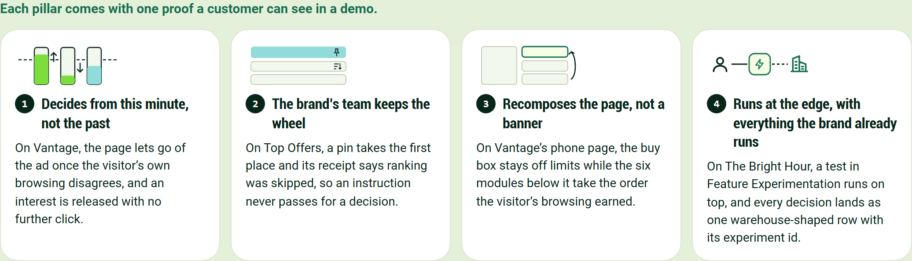
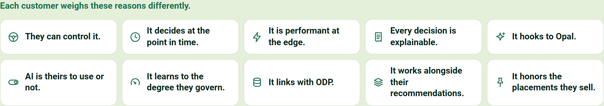
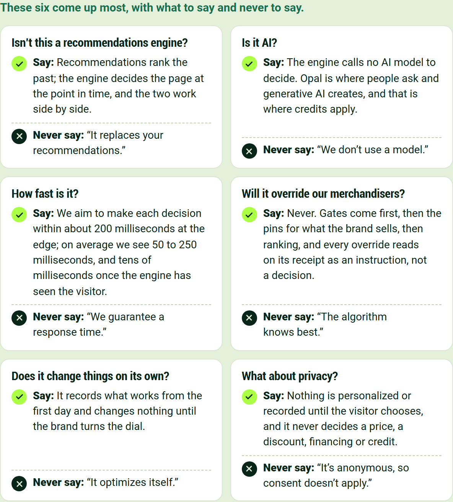
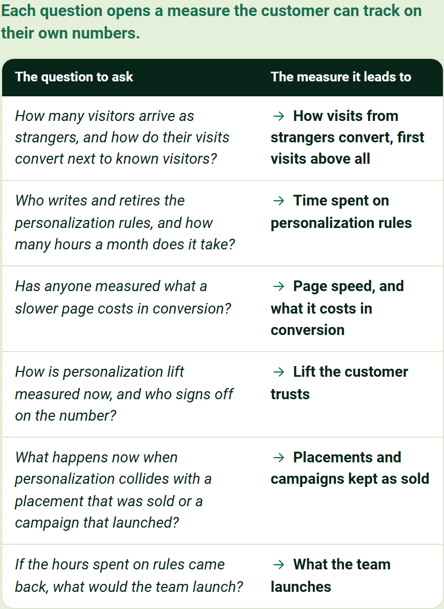
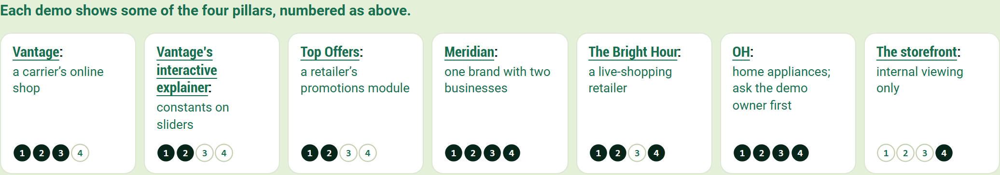
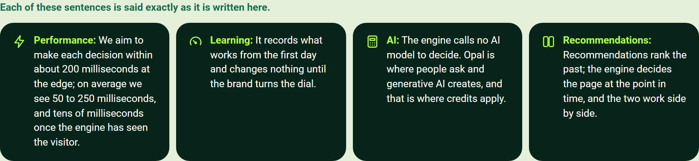

# Behavioral Targeting and Intelligence: battlecard

For account executives: the whole story on one sheet, to read before a call.

## Four pillars carry the pitch, each with a proof

**Decides from this minute, not the past**

On Vantage, the page lets go of the ad once the visitor's own browsing disagrees, and an interest is released with no further click.

**The brand's team keeps the wheel**

On Top Offers, a pin takes the first place and its receipt says ranking was skipped, so an instruction never passes for a decision.

**Recomposes the page, not a banner**

On Vantage's phone page, the buy box stays off limits while the six modules below it take the order the visitor's browsing earned.

**Runs at the edge, with everything the brand already runs**

On The Bright Hour, a test in Feature Experimentation runs on top, and every decision lands as one warehouse-shaped row with its experiment id.

## Customers choose it for different reasons

- They can control it.
- It decides at the point in time.
- It is performant at the edge.
- Every decision is explainable.
- It hooks to Opal.
- AI is theirs to use or not.
- It learns to the degree they govern.
- It links with ODP.
- It works alongside their recommendations.
- It honors the placements they sell.

## Six objections have short answers

**Isn't this a recommendations engine?**

Say: Recommendations rank the past; the engine decides the page at the point in time, and the two work side by side.

Never say: "It replaces your recommendations."

**Is it AI?**

Say: The engine calls no AI model to decide. Opal is where people ask and generative AI creates, and that is where credits apply.

Never say: "We don't use a model."

**How fast is it?**

Say: We aim to make each decision within about 200 milliseconds at the edge; on average we see 50 to 250 milliseconds, and tens of milliseconds once the engine has seen the visitor.

Never say: "We guarantee a response time."

**Will it override our merchandisers?**

Say: Never. Gates come first, then the pins for what the brand sells, then ranking, and every override reads on its receipt as an instruction, not a decision.

Never say: "The algorithm knows best."

**Does it change things on its own?**

Say: It records what works from the first day and changes nothing until the brand turns the dial.

Never say: "It optimizes itself."

**What about privacy?**

Say: Nothing is personalized or recorded until the visitor chooses, and it never decides a price, a discount, financing or credit.

Never say: "It's anonymous, so consent doesn't apply."

## Six questions lead to six measures

| The question to ask | The measure it leads to |
|---|---|
| How many visitors arrive as strangers, and how do their visits convert next to known visitors? | How visits from strangers convert, first visits above all |
| Who writes and retires the personalization rules, and how many hours a month does it take? | Time spent on personalization rules |
| Has anyone measured what a slower page costs in conversion? | Page speed, and what it costs in conversion |
| How is personalization lift measured now, and who signs off on the number? | Lift the customer trusts |
| What happens now when personalization collides with a placement that was sold or a campaign that launched? | Placements and campaigns kept as sold |
| If the hours spent on rules came back, what would the team launch? | What the team launches |

## Each demo shows part of the story

- [Vantage](https://edge-platform-vantage.expedge.workers.dev/vantage/): a carrier's online shop
- [Vantage's interactive explainer](https://edge-platform-vantage.expedge.workers.dev/vantage/how-it-works): constants on sliders
- [Top Offers](https://edge-platform-top-offers.expedge.workers.dev/top-offers/): a retailer's promotions module
- [Meridian](https://edge-platform.expedge.workers.dev/meridian/): one brand with two businesses
- [The Bright Hour](https://edge-platform.expedge.workers.dev/live/): a live-shopping retailer
- [OH](https://edge-platform-oh.expedge.workers.dev/oh/): home appliances; ask the demo owner first
- [The storefront](https://edge-platform.expedge.workers.dev/storefront): internal viewing only

## Four sentences are said word for word

- **Performance:** We aim to make each decision within about 200 milliseconds at the edge; on average we see 50 to 250 milliseconds, and tens of milliseconds once the engine has seen the visitor.
- **Learning:** It records what works from the first day and changes nothing until the brand turns the dial.
- **AI:** The engine calls no AI model to decide. Opal is where people ask and generative AI creates, and that is where credits apply.
- **Recommendations:** Recommendations rank the past; the engine decides the page at the point in time, and the two work side by side.
