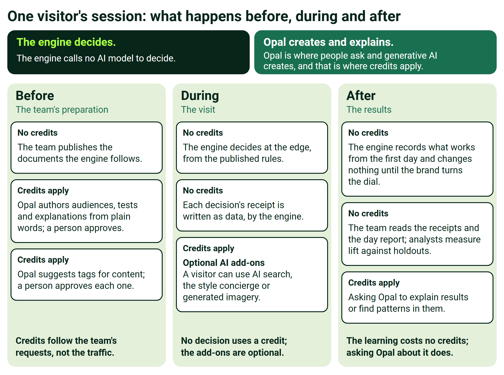

# Behavioral Targeting and Intelligence: Where Opal and AI Credits Fit, and Where They Never Do

**Internal only** AE · Pricing · Deal desk · Sales enablement

The definitive map of which touchpoints consume token-based AI credits and which don't, so quotes are structured correctly and nobody promises, or fears, AI cost in the wrong place.

**The one rule: memorize this**

| During a shopper session | Setup & insight |
|---|---|
| **The engine decides.** | **Opal creates & explains.** |
| Scoring interest, picking content, ranking what each slot shows, giving the page its answer. Deterministic math on edge infrastructure. | A person asks in natural language, or generative AI creates something: an audience, a test, a label, an image, an analysis. |
| **● No AI · no credits · ever** | **● That's Opal · credit-metered** |

**Opal is not connected to the engine today.**

The practical consequence: **AI credit consumption scales with the customer's team activity and feature adoption, never with shopper traffic.** Whether a site has one million sessions or ten million, its credit usage doesn't move.

01 · THE TOUCHPOINT MAP

## Walk one shopper session, start to finish.

Every touchpoint in the offering lands in one of three parts of a shopper's session: before, during or after. **Tap through them.** The middle part, the live session itself, is the one AEs get asked about most, and it's almost entirely credit-free.

- **Credits apply**
- **Deterministic engine · no credits**
- **Conditional / exception**
- **Not decided or not offered**

**Before** Setup & authoring: this is design-time, and it's where credits legitimately live.

| Before | Setup & authoring | Credits apply |
|---|---|---|
| Design-time tagging of the content catalog | The brand's own AI model, on its own key, reads the customer's content and suggests labels; a human approves each one. One-time per content batch, re-run when new content arrives. **Built**, off by default. | **Credits not decided** |
| Create audiences via natural language | “Build me a high-intent evening-shopper audience” → Opal creates it, as designed. **Open**: not wired to the engine today; the demos' stand-in creates audiences in Feature Experimentation, demo only. | **Credits per request** |
| Create tests / experiments via natural language | “Launch a test on the hero for this audience” → Opal creates it in Feature Experimentation, as designed. **Open**: not wired to the engine today. | **Credits per request** |
| Parameter / preset proposals | “Fit my decay settings to my shoppers' actual behavior” → Opal proposes, human approves, as designed. **Open**: not wired to the engine today. | **Credits per request** |

**Credits belong here, and that's correct.** These are people creating things in natural language, or AI tagging content at design time: quote credits against onboarding and steady authoring. Opal is not connected to the engine today, and whether tagging is billed as credits is still open.

**During** The live shopper session: the part AEs get grilled on. Almost entirely credit-free.

| During | The live shopper session | No credits* |
|---|---|---|
| Live interest scoring & audiences | The interest thermometer; shoppers flowing in and out of audiences during their session. | **Never deterministic** |
| Content picks, product re-ranking, the ranked answer | The engine choosing what each shopper sees in each slot, re-ranking a product list the commerce platform supplies, and answering the site, which renders it. | **Never** |
| CMAB serving decisions | The bandit allocating variations at serve time: Optimizely's CMAB, a Feature Experimentation capability outside the engine. Connecting Feature Experimentation to a customer deployment is **Open**, and the CMAB screens in older demos simulate their results, demo only. | **No credits FX licensing** |
| ODP event ingest, seed, profile updates | ODP's own work as events flow in, outside the decision: the decision reads no ODP data. An ODP loop runs for the default demo tenant only, demo only; connecting ODP to a customer deployment is **Open**. | **No credits ODP licensing** |
| Receipts | Every answer's “why,” generated as data by the engine; receipts are kept with the visitor's consent once recording is on. | **Never** |
| Optional shopper-facing AI features **exception** | Typed search (“bags for a winter wedding”), style advisor chat, scene generation. Real generative calls, invoked by a shopper using the feature, and only if the customer licenses them. Typed search is **Built** and off by default; the advisor and scene generation are demo only. | **Metered per use** |

**No page view ever burns a credit.** The decision path is deterministic. The single exception is optional shopper-facing AI, and only if licensed, flagged below.

**After** Analysis, learning & insight: the part where deals get misquoted. Read each row.

| After | Analysis, learning & insight | Mixed: read closely |
|---|---|---|
| The learning itself | Which content converts, for whom: a deterministic statistics pipeline the engine runs on its own data. | **Never the engine** |
| “How is it performing / why did shoppers see X” | Opal narrates results and explains decisions in plain language, as designed. **Open**: Opal is not connected to the engine today, and the engine's own reasons are arithmetic it produces itself. | **Credits per ask** |
| Analytics through Opal | Opal querying and analyzing warehouse & analytics data, as designed. **Open**: not connected to the engine today. | **Credits per ask** |
| Audience discovery from analyzed data | “What cohorts are forming in my data?” → Opal mines and proposes, as designed. **Open**: not connected to the engine today. | **Credits per ask** |
| Discovery proposals from the engine | “A tote-interest cohort is forming: want to activate it?” Proposals the engine raises on its own are switched off by policy and not offered. | **Not offered** |

**The split here is subtle: the learning costs no credits, but asking Opal about it does.** The engine’s own statistics cost no credits; narrating, analyzing, or mining them through Opal is credit-metered, as designed, and Opal is not connected to the engine today.

The single asterisk on "During" is the one thing to keep straight: optional shopper-facing AI features are the lone credit-consuming exception in the live path, and only if the customer licenses them. Everything else during a session is deterministic.

The same session as one figure, with each card's label: Built, Designed or Open.

02 · WHY THIS MATTERS FOR PRICING

## Credits scale with the team. The engine scales with traffic. Never cross the wires.

This is the whole objection-killer. The moment credits appear to scale with traffic, a customer's finance team models worst-case AI cost against their traffic curve, and the deal stalls on a fear that isn't real.

| The engine | Opal / AI credits |
|---|---|
| cost ↑ as sessions ↑ | cost flat as sessions ↑ |
| **Scales with traffic** | **Flat vs. traffic** |
| Platform fee + usage, priced per visitor / session: **Designed**, a recommendation; its rates and the usage meter are **Open**. No AI cost inside it, by architecture. | Sized to the operator team: how often they author audiences, launch tests, ask questions. |

Whether a site has one million sessions or ten million, the left line climbs and the right line doesn't move. That contrast is the cost-predictability selling point and the objection-killer in one picture.

03 · STRUCTURING THE QUOTE

## Three revenue lines, three different meters.

Keep them as separate lines. Each answers to a different driver, and blending them is where quotes go wrong.

**The engine** **Scales with traffic**

Platform fee + usage, per monthly-tracked-visitor or per-1K-sessions: **Designed**, a recommendation; its rates and the usage meter are **Open**. **No AI cost inside it, by architecture.**

**Opal credits** **Scales with team activity**

Credit packs sized to the operator team: merchandisers, analysts, how often they author and ask. **Authoring-heavy months (onboarding, campaign season) burn more; steady-state is modest.**

**Shopper-facing AI features** **Scales with adoption**

Optional add-on line: metered per invocation (searches, advisor conversations, new scenes generated), or bundled as an allowance. **Scales with feature adoption, not page views.** Typed search is **Built** and off by default; the advisor and scene generation are demo only.

**The one thing never to do**

Never blend lines 1 and 2 into one meter. The moment credits appear to scale with traffic, the customer's finance team will model worst-case AI costs against their traffic curve and the deal will stall on a fear that isn't real.

04 · SAY THESE VERBATIM

## Three sentences that settle the AI-cost question.

Each follows the documented credit rule, which is **Designed**; the billing meter is **Open**.

**On traffic & credits**

> Shopper traffic **never** consumes AI credits: the decision path is deterministic math on edge infrastructure, priced as platform usage.

**On what credits track**

> Credits scale with your **team's** questions and creations, such as audiences, tests and analyses, not with your shoppers' clicks.

**On the optional shopper AI features**

> The optional AI shopping features are metered **only when a shopper actually uses them**, so you pay per use, not per view.

05 · QUICK FAQ

## The questions that come up on every deal.

**If the engine is so smart, why doesn't it use AI credits?** Because it deliberately calls *no* AI model to decide: it's transparent scoring math. That's a feature (cost-predictability, explainability), not a limitation. It's the anti-black-box argument that wins engineering teams.

**Does the learning loop cost credits?** No. The learning, which content converts and for whom, is the engine's own statistics pipeline running on its own data. Asking Opal to *explain or analyze* those results is what costs credits, and Opal is not connected to the engine today.

**Is the content auto-tagging a recurring cost?** Per content batch: large at onboarding, a small trickle as new content arrives. Whether it is billed as credits is still open, so quote it with onboarding only once that is decided.

**What if the customer never buys Opal credits?** The engine runs fully without them: no decision calls an AI model, and the team reads receipts and the day report directly in the operator console. Opal is the natural-language accelerant and the transparency narrator, as designed: a strong attach, not a dependency.

**Which products are on the order form?** ODP (the customer data platform), Feature Experimentation (activation/testing), Opal credits (authoring + insight), the engine itself (the new offering line), and optional shopper AI features. ODP and Feature Experimentation have their own licenses and sit outside the decision path. See the map below.

06 · WHAT'S ON THE ORDER FORM

## The five lines, and what drives each.

| Line | What it is | What drives it |
|---|---|---|
| ODP | The customer data platform: profiles, audiences, outcomes. Outside the decision path; connecting it to a customer deployment is **Open**. | **Own licensing** |
| Feature Experimentation | Activation & testing: flags, experiments, CMAB. Outside the decision path; connecting it to a customer deployment is **Open**. | **Own licensing** |
| The engine | The new offering line: in-session interest scoring, content matching, the ranked answer. **Designed** as a recommendation; its rates and usage meter are **Open**. | **Scales with traffic** |
| Opal credits | Authoring + insight: the natural-language layer. | **Scales with team activity** |
| Shopper-facing AI features | Optional: typed search, style advisor, scene generation. Typed search is **Built** and off by default; the advisor and scene generation are demo only. | **Scales with adoption** |

Three different meters across five lines. Each tag names its driver in words, the same words the meters above use.

INTERNAL REFERENCE · OPAL & AI-CREDIT PLACEMENT · AE / PRICING / DEAL DESK

**THE ENGINE DECIDES · OPAL CREATES & EXPLAINS · CREDITS FOLLOW THE TEAM, NOT THE TRAFFIC**
