# Behavioral Targeting and Intelligence: how it works and where it runs

**For solutions engineers.** The story first and why customers choose it, then one visitor walked through, the arithmetic as worked examples, learning and the receipt, where the engine runs and how it is configured, integration and privacy, and what a customer provides.

## Why customers choose it

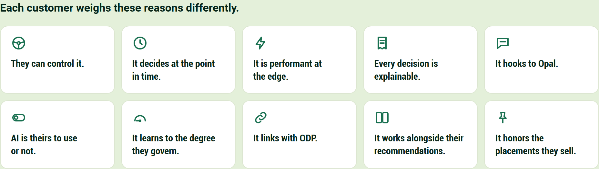

- They can control it.
- It decides at the point in time.
- It is performant at the edge.
- Every decision is explainable.
- It hooks to Opal.
- AI is theirs to use or not.
- It learns to the degree they govern.
- It links with ODP.
- It works alongside their recommendations.
- It honors the placements they sell.

## One visitor's first click becomes the slot's answer in five steps

A stranger in Illinois, arriving from a paid-social ad for a wool coat, views a tailored wool coat, and the figure follows that one view to the edit, a four-piece slot on the homepage.

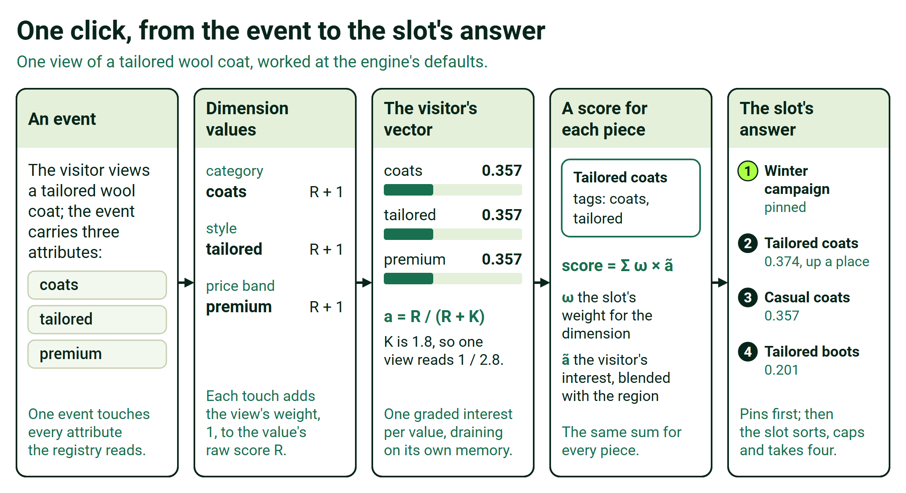

1. **An event.** The visitor views a tailored wool coat, and the event carries the product id and the attributes the registry reads: coats, tailored and premium.
2. **Dimension values.** The registry turns the one view into three touches, on category, style and price band, and each adds the view's weight, 1, to that value's raw score R.
3. **The visitor's vector.** Each value now reads 1/(1 + 1.8) = 0.357; the three sum to 1.07, so λ, the region's share of the blend, falls from 1 to 0.48.
4. **A score for each piece.** Each piece in the edit that may show scores the slot's weight times the visitor's blended interest for each of its tags, added up, plus the ad's seed of 0.06 on pieces tagged coats.
5. **The slot's answer.** The pinned winter campaign keeps place 1; the tailored coats, at 0.374, now pass the casual coats, at 0.357, which led on arrival.

The same arithmetic orders a page's modules. On the coat's page, the styling story rises for a visitor leaning tailored, and the recommendations carousel is one of the six modules the engine orders, still choosing its own products.

An ordering is a ranking, so six modules in ten arrival contexts are sixty numbers to learn, not 720 orders to test. A merchandiser sets each arrival context's starting order, and the layout's rules say which sections are fixed, movable or required.

Every decision runs the same ten steps, from identity and consent to outcomes and the dial; under each step is what governs it.

## Six quantities carry the mechanism, and each one can be worked by hand

Each card shows one quantity at the engine's defaults, worked by hand on an example invented for this page.

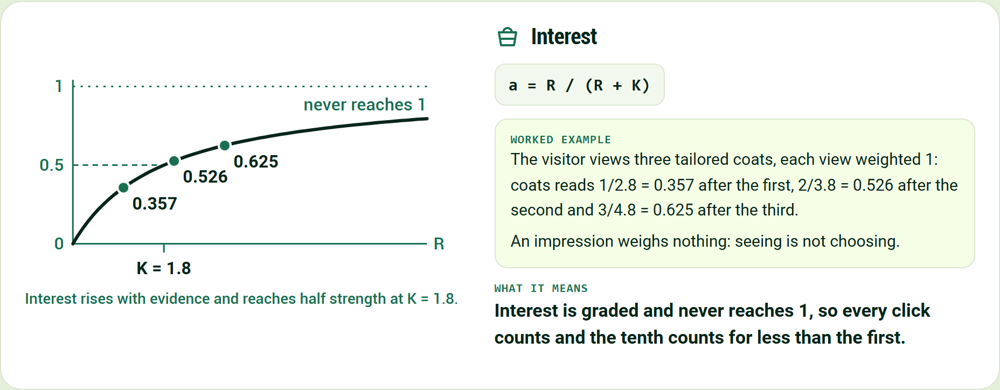

**Interest**

`a = R / (R + K)`

The visitor views three tailored coats, each view weighted 1: coats reads 1/2.8 = 0.357 after the first, 2/3.8 = 0.526 after the second and 3/4.8 = 0.625 after the third.

An impression weighs nothing: seeing is not choosing.

Interest is graded and never reaches 1, so every click counts and the tenth counts for less than the first.

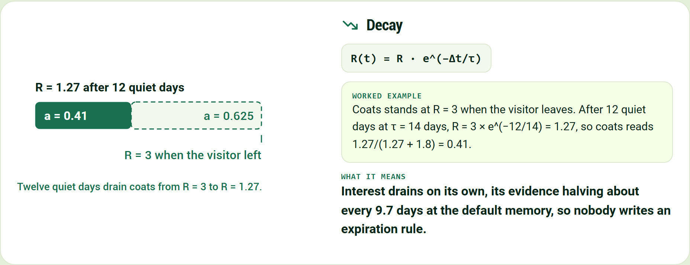

**Decay**

`R(t) = R · e^(−Δt/τ)`

Coats stands at R = 3 when the visitor leaves. After 12 quiet days at τ = 14 days, R = 3 × e^(−12/14) = 1.27, so coats reads 1.27/(1.27 + 1.8) = 0.41.

Interest drains on its own, its evidence halving about every 9.7 days at the default memory, so nobody writes an expiration rule.

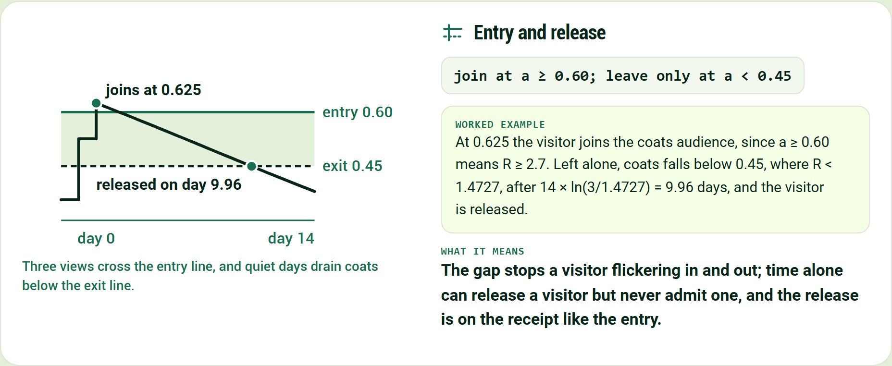

**Entry and release**

`join at a ≥ 0.60; leave only at a < 0.45`

At 0.625 the visitor joins the coats audience, since a ≥ 0.60 means R ≥ 2.7. Left alone, coats falls below 0.45, where R < 1.4727, after 14 × ln(3/1.4727) = 9.96 days, and the visitor is released.

The gap stops a visitor flickering in and out; time alone can release a visitor but never admit one, and the release is on the receipt like the entry.

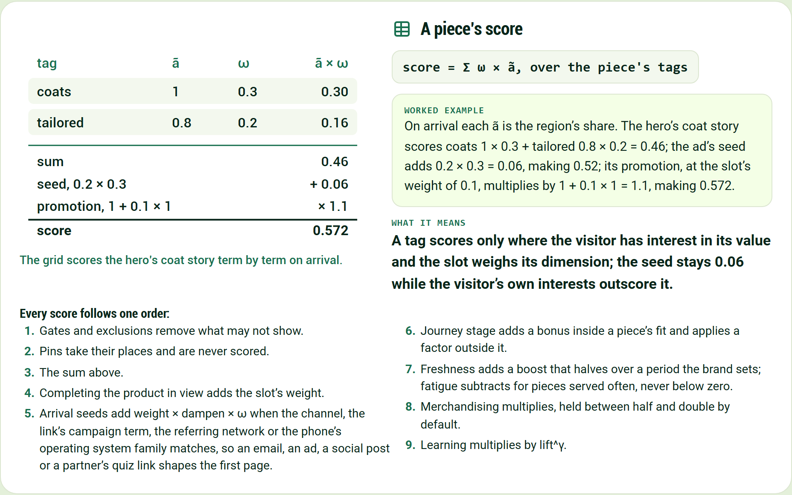

**A piece's score**

`score = Σ ω × ã, over the piece's tags`

On arrival each ã is the region's share. The hero's coat story scores coats 1 × 0.3 + tailored 0.8 × 0.2 = 0.46; the ad's seed adds 0.2 × 0.3 = 0.06, making 0.52; its promotion, at the slot's weight of 0.1, multiplies by 1 + 0.1 × 1 = 1.1, making 0.572.

A tag scores only where the visitor has interest in its value and the slot weighs its dimension; the seed stays 0.06 while the visitor's own interests outscore it.

Every score follows one order:

1. Gates and exclusions remove what may not show.
2. Pins take their places and are never scored.
3. The sum above.
4. Completing the product in view adds the slot's weight.
5. Arrival seeds add weight × dampen × ω when the channel, the link's campaign term, the referring network or the phone's operating system family matches, so an email, an ad, a social post or a partner's quiz link shapes the first page.
6. Journey stage adds a bonus inside a piece's fit and applies a factor outside it.
7. Freshness adds a boost that halves over a period the brand sets; fatigue subtracts for pieces served often, never below zero.
8. Merchandising multiplies, held between half and double by default.
9. Learning multiplies by lift^γ.

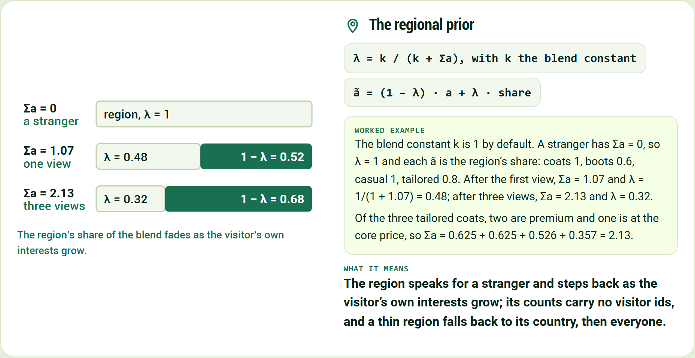

**The regional prior**

`λ = k / (k + Σa)`

`ã = (1 − λ) · a + λ · share`

A stranger has Σa = 0, so λ = 1 and each ã is the region's share: coats 1, boots 0.6, casual 1, tailored 0.8. After the first view, Σa = 1.07 and λ = 1/(1 + 1.07) = 0.48; after three views, Σa = 2.13 and λ = 0.32.

The region speaks for a stranger and steps back as the visitor's own interests grow; its counts carry no visitor ids, and a thin region falls back to its country, then everyone.

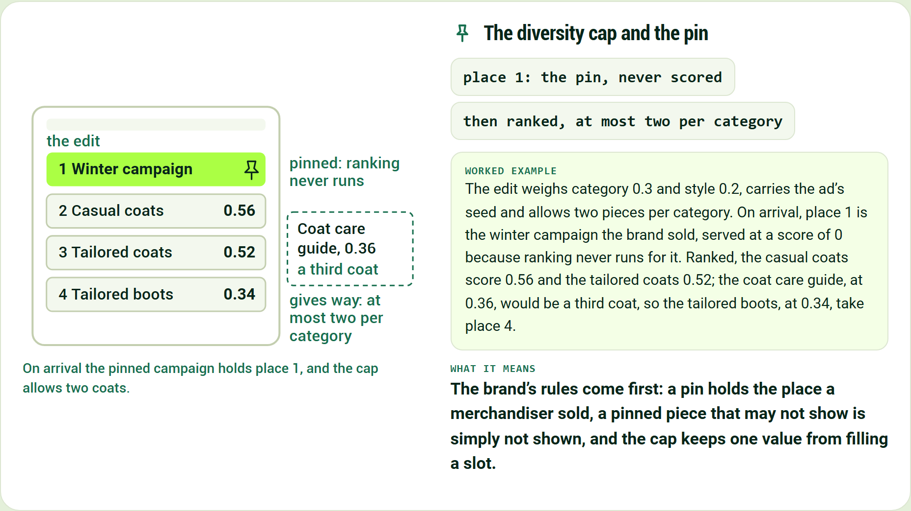

**The diversity cap and the pin**

`place 1: the pin, never scored`

`then ranked, at most two per category`

The edit weighs category 0.3 and style 0.2, carries the ad's seed and allows two pieces per category. On arrival, place 1 is the winter campaign the brand sold, served at a score of 0 because ranking never runs for it. Ranked, the casual coats score 0.56 and the tailored coats 0.52; the coat care guide, at 0.36, would be a third coat, so the tailored boots, at 0.34, take place 4.

The brand's rules come first: a pin holds the place a merchandiser sold, a pinned piece that may not show is simply not shown, and the cap keeps one value from filling a slot.

The engine's defaults are K = 1.8, an entry line at 0.60, an exit line at 0.45, a memory τ of 14 days and a blend constant k of 1; the example brand weighs a view 1, as the engine's own table does, and its slot weights and its region's shares are invented for this page.

## Learning waits behind the dial, and every decision keeps a receipt

The figure shows the learning dial, the holdout that keeps a comparison, and the receipt for the tailored coats after the first click.

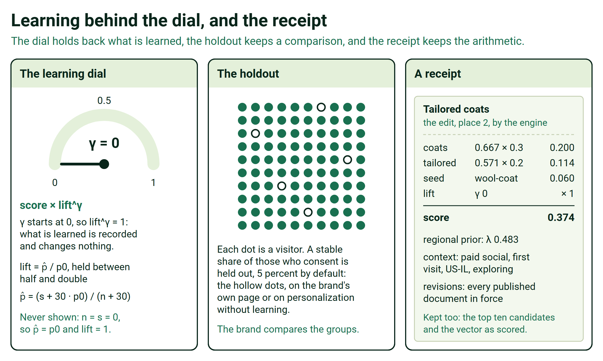

It records what works from the first day and changes nothing until the brand turns the dial.

- An outcome is credited to the last decision before it for the same visitor, session and piece: by default within 30 minutes for a click, 6 hours for an add to cart and 7 days for a purchase.
- If the visitor buys the tailored boots the edit served, the purchase is credited to that decision and counted for that piece in its context.
- Learning compares each piece with its slot's usual rate in the same context, pooling similar contexts when one is thin, and each slot learns toward the outcome the brand names: clicks, adds to cart, purchases, revenue or margin.
- The holdout keeps a stable share of consenting visitors on the brand's own page or on personalization without learning, and the brand measures lift against it on its own numbers.
- Exploration, off unless the brand turns it on, gives a share of views to less-tried pieces, and neighboring modules sometimes swap places so learning can tell position from appeal.
- Every answer carries the reasons that placed each piece; the receipt keeps the arithmetic and what is needed to replay it, so a replay of its slot comes out the same.

## It runs at the edge, and every setting is a published document

The figure shows what runs where: the Worker, what each Worker keeps, each deployment's own storage, and the products beside it.

The engine is one Worker per deployment, in the data center nearest each request. Each customer has its own deployment for staging and for production, and each brand inside it is a tenant whose data never pools with another's.

We aim to make each decision within about 200 milliseconds at the edge; on average we see 50 to 250 milliseconds, and tens of milliseconds once the engine has seen the visitor.

A decision is arithmetic over the visitor's state and the brand's published settings, held at the edge, with no AI model and no round trip to a central database. Every decision and outcome also lands in the brand's own warehouse, on a cadence the brand sets, from a minute to a day.

Four published documents hold everything the brand tunes; the console and the API change them, every save becomes a new revision, and a change is in force without a software release.

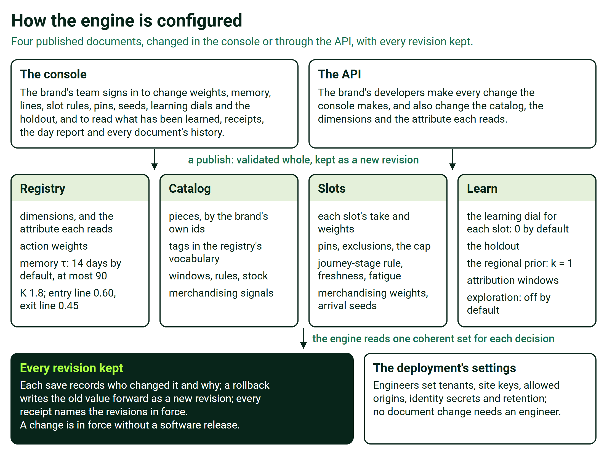

Imported priors, a warehouse's starting beliefs per piece and context, sit beside them.

## The site connects once, and privacy holds on every request

One script starts the visitor's session, sends events or reads the brand's existing data layer, and receives every slot's decision by id in one call.

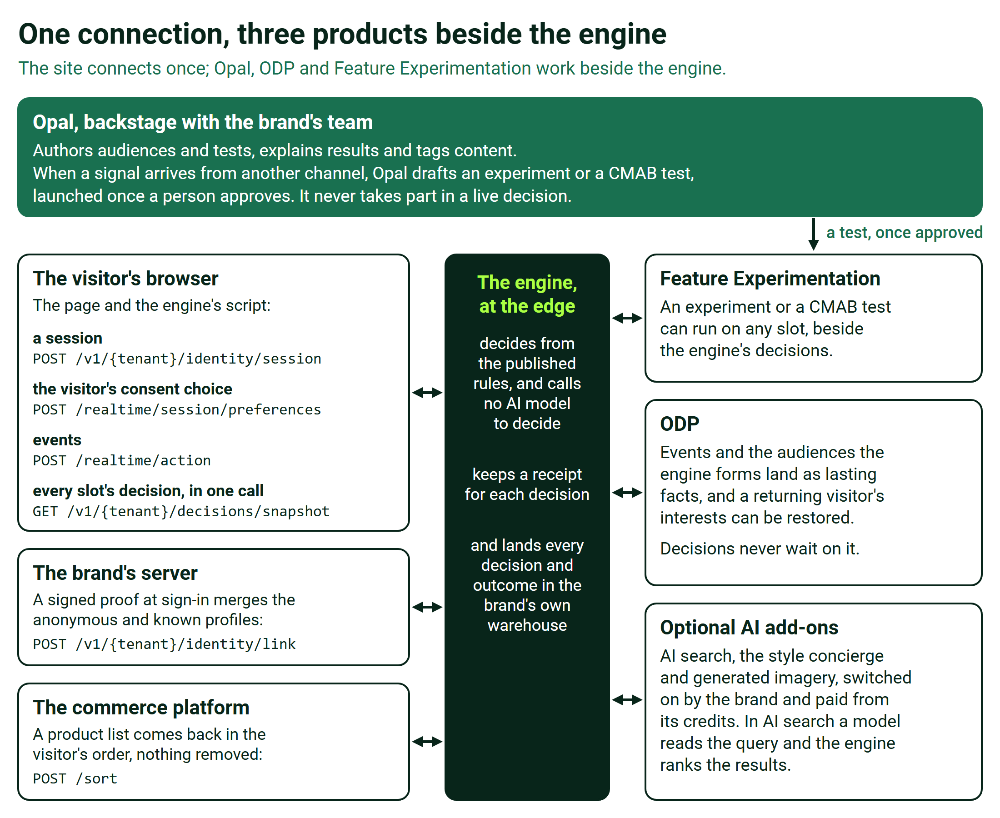

When no answer arrives in time, the site's own default stands, and the brand's server can fetch the first page's decisions before the page is sent.

The front end is built once, and every other capability is switched on in configuration. Developers work from the integration kit: the SDK, the API reference, the payload schemas and a staging connection check.

When Opal proposes tags for thinly labeled content, a person approves, edits or rejects each one before it is used.

The engine calls no AI model to decide. Opal is where people ask and generative AI creates, and that is where credits apply. [Where Opal and AI Credits Fit, and Where They Never Do](https://edge-platform-bti.expedge.workers.dev/credits) sets out the boundary.

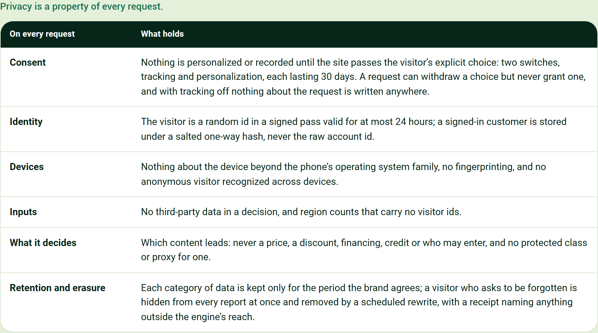

| On every request | What holds |
|---|---|
| Consent | Nothing is personalized or recorded until the site passes the visitor's explicit choice: two switches, tracking and personalization, each lasting 30 days. A request can withdraw a choice but never grant one, and with tracking off nothing about the request is written anywhere. |
| Identity | The visitor is a random id in a signed pass valid for at most 24 hours; a signed-in customer is stored under a salted one-way hash, never the raw account id. |
| Devices | Nothing about the device beyond the phone's operating system family, no fingerprinting, and no anonymous visitor recognized across devices. |
| Inputs | No third-party data in a decision, and region counts that carry no visitor ids. |
| What it decides | Which content leads: never a price, a discount, financing, credit or who may enter, and no protected class or proxy for one. |
| Retention and erasure | Each category of data is kept only for the period the brand agrees; a visitor who asks to be forgotten is hidden from every report at once and removed by a scheduled rewrite, with a receipt naming anything outside the engine's reach. |

## Every ask says what we need and what we use it for

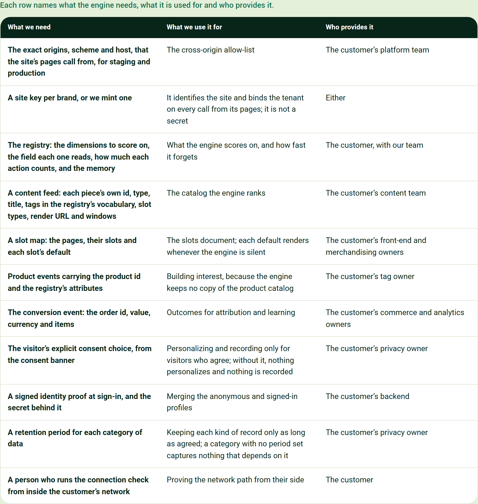

| What we need | What we use it for | Who provides it |
|---|---|---|
| The exact origins, scheme and host, that the site's pages call from, for staging and production | The cross-origin allow-list | The customer's platform team |
| A site key per brand, or we mint one | It identifies the site and binds the tenant on every call from its pages; it is not a secret | Either |
| The registry: the dimensions to score on, the field each one reads, how much each action counts, and the memory | What the engine scores on, and how fast it forgets | The customer, with our team |
| A content feed: each piece's own id, type, title, tags in the registry's vocabulary, slot types, render URL and windows | The catalog the engine ranks | The customer's content team |
| A slot map: the pages, their slots and each slot's default | The slots document; each default renders whenever the engine is silent | The customer's front-end and merchandising owners |
| Product events carrying the product id and the registry's attributes | Building interest, because the engine keeps no copy of the product catalog | The customer's tag owner |
| The conversion event: the order id, value, currency and items | Outcomes for attribution and learning | The customer's commerce and analytics owners |
| The visitor's explicit consent choice, from the consent banner | Personalizing and recording only for visitors who agree; without it, nothing personalizes and nothing is recorded | The customer's privacy owner |
| A signed identity proof at sign-in, and the secret behind it | Merging the anonymous and signed-in profiles | The customer's backend |
| A retention period for each category of data | Keeping each kind of record only as long as agreed; a category with no period set captures nothing that depends on it | The customer's privacy owner |
| A person who runs the connection check from inside the customer's network | Proving the network path from their side | The customer |

Optional, each with its use: candidate product lists from the commerce platform, for re-ranking; a catalog-search service, for AI search; historical rows, which start known customers warm; regional sales from the brand's warehouse, which set each region's starting lean; and a warehouse destination for the receipts and outcomes.

## The interactive page puts every constant on a slider

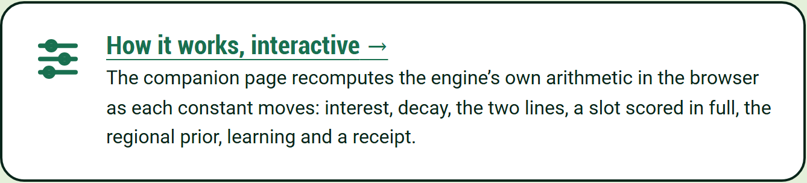

**[How it works, interactive](https://edge-platform-bti.expedge.workers.dev/how-it-works-interactive)**
