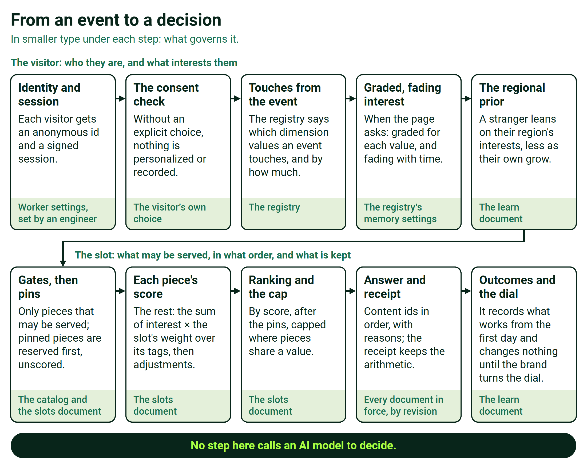
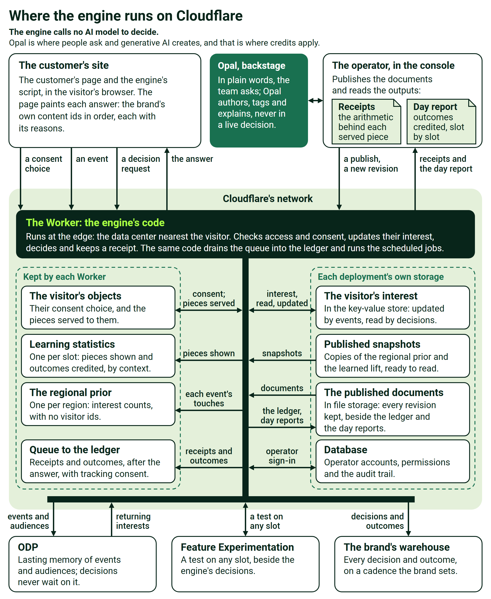

# Behavioral Targeting and Intelligence: how it works and where it runs

**For solutions engineers.** The story comes first, in two pages; then one visitor walked through end to end, the mechanism and its arithmetic, the architecture on Cloudflare, configuration, integration, privacy and what a customer provides, each part of the story linked to its detail and back. The companion page, [How it works, interactive](https://edge-platform-bti.expedge.workers.dev/how-it-works-interactive), puts the constants on sliders, and a live demo's [How it works](https://edge-platform-vantage.expedge.workers.dev/vantage/how-it-works) page is a worked example. Every word follows the [Glossary](https://edge-platform-bti.expedge.workers.dev/glossary).

> **The engine decides each page at the point in time from what the visitor is doing now, under rules the brand publishes, and writes every decision out as arithmetic a person can recompute.**

## Part A. The story

## A.1 Most visitors are strangers, and the tools built for known customers cannot see them

In one luxury retailer's own count, nine visitors in ten arrive unidentified, about four in five have never been seen before, and four purchases in ten happen on the first visit. Most buying happens before any profile exists, and tools built for known customers are blind in that window. The rules written to compensate, one for each campaign and each kind of visitor, go stale, multiply and start to fight. The retailer's own setup, built on eight to ten audience lists, "works, but it caps out", and its scan of more than ten vendors found "none of them offer real-time, ML-driven content or experience personalization at the individual level." The engine is built for that window.

The detail: [B.1](#b1-one-visitor-walked-through-end-to-end)

## A.2 It is a personal stylist for every visitor, at internet scale

The engine reads the room: where the visitor is and how they arrived. It watches without interrogating: no form, no login, only what the visitor does. It rearranges the table: the page's sections and the pieces inside them, in this visitor's order. And it pivots when attention moves. The same retailer's paper asked for "a site that feels like a stylist who remembers."

Recommendations rank the past; the engine decides the page at the point in time, and the two work side by side. It is not a recommendations engine and does not replace one; it organizes the page by interest, in real time, around whatever recommendations exist.

The detail: [B.3](#b3-a-pieces-score-is-a-dot-product-under-the-slots-weights)

## A.3 What it does: thirteen capabilities, each with its use

- **The first page feels local before the first click.** It leans on what the visitor's real region favors, read from the request, until their own interests take over ([B.4](#b4-a-stranger-starts-from-the-region-and-the-arrival)).
- **The first click changes the page.** With consent, the next page or slot reflects the first action, with no login ([B.2](#b2-interest-is-a-number-anyone-can-check)).
- **Every channel seeds the visit.** An email, an ad, a social post, a campaign term on a link (a partner's quiz link included), the referring network or the phone's operating system family lifts matching content ([B.4](#b4-a-stranger-starts-from-the-region-and-the-arrival)).
- **Interest fills and drains like a bucket.** Each action pours its weight into a bucket for every dimension value it touches; each bucket drains on its own memory and fills toward a cap. A visitor joins an audience at an entry line and leaves below a lower exit line, so nobody writes expiration rules, and the release is on the receipt ([B.2](#b2-interest-is-a-number-anyone-can-check)).
- **The page's sections reorganize by interest.** The engine orders the page's modules, not only what fills a slot, and a recommendations carousel is one of them: it chooses its products, the engine its place ([B.3](#b3-a-pieces-score-is-a-dot-product-under-the-slots-weights)).
- **Merchandisers keep the wheel.** Gates remove what may not show, pins hold the sections the brand sells, the engine ranks the rest, and every override and decision is written out as arithmetic on a receipt a person can recompute ([B.3](#b3-a-pieces-score-is-a-dot-product-under-the-slots-weights), [B.5](#b5-learning-waits-for-the-dial-and-the-receipt-shows-everything)).
- **Every constant is tuned in plain view.** Marketers and data scientists set weights, memories, lines and dials in published, versioned documents and the console, with no software release ([B.7](#b7-every-setting-is-a-published-document-changed-without-a-release)).
- **It learns behind a dial the brand controls.** It records what works from the first day and changes nothing until the brand turns the dial. Holdouts run from the start, so the brand measures the lift ([B.5](#b5-learning-waits-for-the-dial-and-the-receipt-shows-everything)).
- **Opal works with it.** The brand's team asks Opal to author audiences and tests, explain results, tag content, and propose and launch experiments and contextual-bandit tests on signals, each launch approved by a person ([B.8](#b8-the-site-connects-once-and-opal-odp-and-feature-experimentation-link-beside-the-engine)). The engine calls no AI model to decide. Opal is where people ask and generative AI creates, and that is where credits apply.
- **It links with ODP and Feature Experimentation.** Its events and audiences land in ODP, and an experiment or contextual bandit can be pointed at any slot ([B.8](#b8-the-site-connects-once-and-opal-odp-and-feature-experimentation-link-beside-the-engine)).
- **Optional AI add-ons serve shoppers.** A brand may switch on AI search, a style concierge and generated imagery, paid from its credits ([B.8](#b8-the-site-connects-once-and-opal-odp-and-feature-experimentation-link-beside-the-engine)).
- **Identity carries across sign-in.** The anonymous and known profiles merge, so nothing done before sign-in is lost ([B.1](#b1-one-visitor-walked-through-end-to-end)).
- **It runs at the edge, on Cloudflare.** Each decision is made close to the visitor and lands, with its outcome, in the brand's own warehouse ([B.6](#b6-it-runs-on-cloudflares-network-in-the-data-center-nearest-the-visitor)).

The detail: [B.2](#b2-interest-is-a-number-anyone-can-check) to [B.8](#b8-the-site-connects-once-and-opal-odp-and-feature-experimentation-link-beside-the-engine)

## A.4 Customers choose it for ten reasons, and each weighs them differently

Customers choose it because they can control it; it decides at the point in time; it is fast at the edge; every decision is explainable; it hooks to Opal; AI is theirs to use or not; it learns only as far as they govern; it links with ODP; it works alongside their recommendations; and it honors the placements they sell. Each customer weighs them differently, so no list ranks them.

The detail: [B.5](#b5-learning-waits-for-the-dial-and-the-receipt-shows-everything) and [B.6](#b6-it-runs-on-cloudflares-network-in-the-data-center-nearest-the-visitor)

## A.5 How it works, in four sentences

For each dimension value a visitor touches, the engine keeps an interest that rises with each action and fades with time. When a page asks, it removes what the brand's rules forbid, holds the brand's pins, and scores every other piece as the visitor's interests times the slot's weights, added up. For a stranger, the region's interests and the arrival stand in until the visitor's own take over. Every decision carries its reasons, and its receipt holds the arithmetic.

The detail: [B.1](#b1-one-visitor-walked-through-end-to-end) to [B.5](#b5-learning-waits-for-the-dial-and-the-receipt-shows-everything)

## A.6 What a customer provides, and what we use it for

The customer provides the content it already has, by its own ids, for the engine to rank; a map of its pages and slots, with the default each slot shows when the engine is silent; events carrying the attributes that build interest; the visitor's consent choice, without which nothing personalizes; a signed proof at sign-in, to merge profiles; and a retention period for each kind of data.

The detail: [B.10](#b10-what-a-customer-provides-and-what-we-use-it-for)

## Part B. The detail

## B.1 One visitor, walked through end to end

Back to the story: [A.1](#a1-most-visitors-are-strangers-and-the-tools-built-for-known-customers-cannot-see-them) and [A.3](#a3-what-it-does-thirteen-capabilities-each-with-its-use)

A fashion brand scores on three dimensions: category, style and price band. Its homepage has a hero and a four-piece slot called the edit; its product page stacks six modules, one of them a recommendations carousel. The numbers use the engine's defaults and this brand's own slot weights.

**Arrival.** A stranger in Illinois taps a paid-social ad for a wool coat on a phone. The site's banner passes the visitor's consent, and the first call returns an anonymous id. The request places the visitor in US-IL, where coats lead this week's category counts with a share of 1 and boots follow at 0.6. With no interests of their own, the stranger is scored wholly on the region: λ, the region's share of the blend, is 1. The ad's link carries the campaign term wool-coat, and the brand's seed for that term adds 0.2, times the slot's weight for category, 0.3, to every piece tagged coats: 0.06 ([B.4](#b4-a-stranger-starts-from-the-region-and-the-arrival)).

The hero's coat story scores the coats share, 1, times category's weight, 0.3, plus the tailored share, 0.8, times style's weight, 0.2: 0.46. The seed makes it 0.52, and the story's promotion, at the slot's promotion weight of 0.1, multiplies it by 1.1, to 0.572. It leads the hero ([B.3](#b3-a-pieces-score-is-a-dot-product-under-the-slots-weights)).

**The first click.** The visitor views a tailored wool coat at the premium price. The view, weighted 1, touches three values at once: coats, tailored and premium each reach a raw score of 1, an interest of 1/(1 + 1.8) = 0.357 ([B.2](#b2-interest-is-a-number-anyone-can-check)). The visitor's interests now sum to 1.07, so λ falls to 1/(1 + 1.07) = 0.48, and on the next page coat and tailored pieces move up in the edit.

**Three views in.** Two more tailored coats follow, one at the core price and one premium. Coats and tailored reach a raw score of 3, an interest of 3/4.8 = 0.625, above the entry line of 0.6, so the visitor joins both audiences; premium reads 0.526 and core 0.357. Nobody wrote a rule: the audience is the line.

**The product page.** On the coat's page, the six modules come back in this visitor's order, the styling story raised for a visitor leaning tailored: size and fit, the styling story, reviews, the recommendations carousel, the care guide, delivery and returns. The carousel still chooses its own products, and the buy box is off limits ([B.3](#b3-a-pieces-score-is-a-dot-product-under-the-slots-weights)).

**A pin holds.** The brand has sold the edit's first place to its winter campaign, so that piece is pinned: reserved before anything is scored and served first at a score of 0, its receipt saying ranking never ran for it. The other three places are ranked for this visitor.

**Attention moves.** The visitor turns to boots and views two pairs. Boots rises to 0.526, and the next page brings boots forward in the edit. The campaign's 0.06 is still added and simply outscored: a seed never switches off, and the visitor's own behavior wins.

**The visitor leaves, and interest drains.** At the default memory of 14 days, coats, at a raw score of 3, falls below the exit line of 0.45 after 14 × ln(3/1.4727) = 9.96 days with no further event ([B.2](#b2-interest-is-a-number-anyone-can-check)). The visitor leaves the coats audience on that clock, the coat content steps back, and the next decision's receipt records the release.

**The return.** The brand recognizes returning visitors, so when the visitor comes back twelve days after the first visit, their interests are there, cooled rather than reset: coats reads 0.41, below its exit line, and boots 0.32, so the region leans in a little again. The visitor taps a boots story in the edit, signs in at checkout and buys. At sign-in the brand's server signs a short proof, and the two profiles merge, adding interests and overriding nothing.

**The outcome.** The purchase is credited to the decision that served the boots story in this session, inside the purchase window, and counted for that story in its context. The decision and the outcome land in the brand's warehouse, where its analysts compare personalized visitors with the holdout ([B.5](#b5-learning-waits-for-the-dial-and-the-receipt-shows-everything)).

Every step above is on a receipt: the terms that decided, the seed's 0.06, the promotion's 1.1, the region's share and λ, the pin, the release and the revision of every setting in force.

## B.2 Interest is a number anyone can check

Back to the story: [A.3](#a3-what-it-does-thirteen-capabilities-each-with-its-use) and [A.5](#a5-how-it-works-in-four-sentences); the walk: [B.1](#b1-one-visitor-walked-through-end-to-end)

For each dimension value, the engine stores a raw score R and the time of the last touch, never a faded number. An event fades R to now and adds the action's weight; a read fades R to the moment of the request and turns it into an interest between 0 and just under 1.

```
event:  R ← R · e^(−Δt/τ) + w,   and the last touch becomes now
read:   a = R(t) / (R(t) + K),    R(t) = R · e^(−(t − t_last)/τ)
enter:  a ≥ 0.6    ⇔   R ≥ 2.7          (K = 1.8)
leave:  a < 0.45   ⇔   R < 1.4727
exit:   t_exit = t_last + τ · ln( R / 1.4727 )
```

| Setting | Default | Where the brand sets it |
|---|---|---|
| Memory, τ | 14 days, at most 90 | The registry, overall or per dimension |
| K, the evidence for half strength | 1.8 | The registry, overall or per dimension |
| Entry line | 0.6 | The registry, overall or per dimension |
| Exit line | 0.45 | The registry, overall or per dimension |
| Action weights | The brand's own, for example a view 1, a wishlist add 2, an add to cart 3, a purchase 5, a mere impression 0 | The registry |
| Values kept per dimension | 24, the weakest dropped first | The registry |

| A view of one value, weighted 1 | Raw score | Interest | Audience |
|---|---|---|---|
| Once | 1 | 0.357 | Below the entry line |
| Twice | 2 | 0.526 | Below the entry line |
| Three times | 3 | 0.625 | Joins, at or above 0.6 |
| Three times, then quiet for about ten days | 1.47 | 0.45 | Leaves, below 0.45 |

Time alone can take a visitor out of an audience but never put one in, and the engine computes the moment interest crosses the exit line, so release needs no clean-up job. One event touches every dimension whose attribute it carries, and where the catalog names a dimension's values, an event value outside them builds nothing. Interest approaches 1 without reaching it, so the tenth click counts for less than the first. An impression weighs nothing: seeing is not choosing.

## B.3 A piece's score is a dot product under the slot's weights

Back to the story: [A.2](#a2-it-is-a-personal-stylist-for-every-visitor-at-internet-scale) and [A.5](#a5-how-it-works-in-four-sentences); the walk: [B.1](#b1-one-visitor-walked-through-end-to-end)

Every piece carries tags in the brand's vocabulary, and every slot gives each dimension a weight, ω, from 0 to 1. A piece's base score is the visitor's blended interest ã in each of its tags, which [B.4](#b4-a-stranger-starts-from-the-region-and-the-arrival) defines, times the slot's weight for that tag's dimension, added up: a dot product.

```
B0 = Σ over the piece's tags of ω[slot, dimension] · ã(value)
```

| Order | Step | What it does |
|---|---|---|
| 1 | Gates | A piece must be live, inside its window, in stock, and pass its own rule, such as a list of regions; a rule that cannot be checked fails closed |
| 2 | Exclusions and off-limits slots | Pieces, tags or types a slot never shows, and whole slots the engine never touches |
| 3 | Pins | The pieces the brand has sold take their places, at any position, and are never scored |
| 4 | The base | The dot product above |
| 5 | Completing the product in view | Adds the slot's weight to pieces that complete the product on the page |
| 6 | Arrival seeds | Add each fired seed's weight, as [B.4](#b4-a-stranger-starts-from-the-region-and-the-arrival) shows |
| 7 | Journey stage | Adds a bonus inside a piece's journey-stage fit, and a factor outside it |
| 8 | Freshness and fatigue | Add a boost that halves over the brand's chosen period, and subtract for pieces this visitor has been served often |
| 9 | Merchandising weights | Multiply by season, promotion and margin factors, held to half to double by default |
| 10 | Learning | Multiplies by lift^γ, which is 1 while γ is 0 |

The slot sorts by score, ties going to the catalog's order. A diversity cap keeps one value from filling it, such as two pieces at most from one line; no piece appears twice on a page; and with no signal the slot serves the catalog's order, labeled the default. Per candidate, the cost is one lookup and one multiply-add per tag value, a check per seed, up to three merchandising factors and one power.

**Modules are pieces too.** A page's sections are the pieces of one slot, so the same arithmetic orders the page, the recommendations carousel among them. The luxury retailer's program head asked how a page could learn its order without versions to learn from: "How else would it learn? I don't understand." An ordering is a ranking: the engine scores each module for this visitor in this context and sorts, so six modules in ten arrival contexts are sixty numbers to learn, not 720 orders to test. A merchandiser sets each arrival context's starting order, and the layout's rules say which sections are fixed, movable or required.

## B.4 A stranger starts from the region and the arrival

Back to the story: [A.3](#a3-what-it-does-thirteen-capabilities-each-with-its-use); the walk: [B.1](#b1-one-visitor-walked-through-end-to-end)

Every scored event also adds its touches, at the action's weight and with no visitor id, to a count for the visitor's region, which the request resolves, on a one-day memory. A value's share is its count over its dimension's leader, so the leader reads 1, and a region with too few events falls back to its country, then to everyone. A brand can set each region's starting lean from its own warehouse sales, labeled with the source.

```
share(v) = R_region(v) / max R_region       within one dimension
λ = kBlend / (kBlend + Σa)                   kBlend = 1 by default
ã = (1 − λ) · a + λ · share
```

| The visitor's interests, summed | λ, the region's share of the blend |
|---|---|
| 0, a stranger | 1 |
| 1.07, after one view touching three values | 0.48 |
| 2.13, after three views | 0.32 |
| 4 | 0.2 |

Arrival seeds work beside the region. A seed fires on how the visitor arrived: the channel (direct, paid social, paid search, email, organic or referral), the link's campaign term, ignoring case, the referring network or the phone's operating system family. It adds its weight, times any dampening, times the slot's weight on the tag's dimension, so a campaign term on any link, from an email, an ad, a social post or a partner's quiz, reaches the first page.

```
seed = weight · Π dampen · ω[slot, dimension of the tag]
```

A seed never switches off. It is dampened when the visitor's own audiences point elsewhere and outscored as their interests grow, and the receipt shows every seed that fired and what it added.

## B.5 Learning waits for the dial, and the receipt shows everything

Back to the story: [A.3](#a3-what-it-does-thirteen-capabilities-each-with-its-use) and [A.4](#a4-customers-choose-it-for-ten-reasons-and-each-weighs-them-differently); the walk: [B.1](#b1-one-visitor-walked-through-end-to-end)

With the visitor's consent, the engine records every decision it serves and every outcome that follows. An outcome is credited to the last decision before it for the same visitor, session and piece, within windows the brand sets (by default 30 minutes for a click, 6 hours for an add to cart and 7 days for a purchase), and a purchase can credit a piece that featured one of its products.

Learning counts, per piece and per context, how much better the piece does than its slot's usual rate, pooling similar contexts when one is thin:

```
p̂ = (s + n0 · p0) / (n + n0)       n0 = 30
lift = clamp(p̂ / p0, 0.5, 2)
score_final = score · lift^γ        0 ≤ γ ≤ 1, set per slot
```

It records what works from the first day and changes nothing until the brand turns the dial. While γ is 0, every receipt still shows the lift learning would apply. Each slot learns toward the outcome the brand names: clicks, adds to cart, purchases, revenue or margin. A new piece starts from its slot's usual rate or from the pieces most like it, a share of views the brand sets goes to less-tried pieces, and neighboring modules sometimes swap places so learning can tell position from appeal. A holdout keeps a stable share of visitors, assigned before their first recorded decision, on the brand's own page or on personalization without learning, and the brand's analysts measure lift against it on their own numbers.

**The receipt.** Every answer carries the reasons that placed each piece, and every served decision has a receipt:

| Part | What it holds |
|---|---|
| Where it was served | The page, slot and position, and the piece's ids |
| Candidates | The top ten, with their scores |
| Context | Arrival channel, visit band, region, leading interest and journey stage |
| Authority | Who decided: the engine, a pin or the default |
| Explain | The drivers, the base score, the regional block with λ, every seed, every multiplier, the lift and the final score |
| Versions | The revision of every published document in force |
| Replay inputs | The visitor's interests as scored and the region's shares, so the decision replays exactly for its slot |

A release is recorded like an entry, and a person can recompute any score from the receipt by hand.

## B.6 It runs on Cloudflare's network, in the data center nearest the visitor

Back to the story: [A.3](#a3-what-it-does-thirteen-capabilities-each-with-its-use) and [A.4](#a4-customers-choose-it-for-ten-reasons-and-each-weighs-them-differently)

The engine is one Worker per deployment: a program on Cloudflare's network that runs in the data center nearest each request. Each customer has its own deployment for staging and for production, with its own storage of every kind, and each brand inside it is a tenant whose data sits under its own prefix; nothing pools across brands. A decision is arithmetic over the visitor's state and the brand's published settings, held at the edge, with no AI model and no round trip to a central database. We aim to make each decision within about 200 milliseconds at the edge; on average we see 50 to 250 milliseconds, and tens of milliseconds once the engine has seen the visitor.

The first figure follows one event to one decision, step by step.



The second shows what runs where.



| Part | What it holds or does |
|---|---|
| The Worker | Checks access and consent, updates interest, decides, writes the receipt, hands records to the ledger and runs the scheduled jobs |
| The visitor's objects (Durable Objects) | One small program per visitor, with its own storage: consent, session grants, the decisions served |
| The visitor's interests (KV, the key-value store) | A record held at the edge with the visitor's session |
| Region counts | One object per region, counting interest with no visitor ids |
| Learning counts | One object per slot, counting pieces shown and outcomes credited, by context |
| Published snapshots (KV) | The regional lean and the learned lift, kept where every decision reads them fast |
| File storage (R2) | The published documents with every revision, the ledger of receipts and outcomes, and the day reports |
| The database (D1) | Operator accounts, grants and the audit trail |
| The queue | Hands receipts and outcomes to the ledger after the answer |
| Scheduled jobs | Fold each hour's records, build the day report, roll regions up into countries and carry erasures through the ledger |

Every decision and outcome record also lands in the brand's own warehouse, on a cadence the brand sets, from a minute to a day, with visitor ids replaced by a pseudonymous subject.

## B.7 Every setting is a published document, changed without a release

Back to the story: [A.3](#a3-what-it-does-thirteen-capabilities-each-with-its-use)

Four published documents hold everything the brand tunes:

- The **registry** names the dimensions, the attribute each reads, the action weights, the memory and the lines.
- The **catalog** lists the pieces by the brand's own ids, with their tags, windows, rules and merchandising signals.
- The **slots document** sets each slot's take, weights, pins, exclusions, journey-stage rule, freshness, fatigue, diversity cap, merchandising weights and arrival seeds.
- The **learn document** holds the learning dial, the holdout, the regional prior, the attribution windows and exploration.

Imported priors, a warehouse's starting beliefs per piece and context, sit beside them. Every save is validated whole, kept as a revision with who changed it and why, and in force without a software release. A rollback writes the old value forward as a new revision, and every receipt names the revisions in force.

| Who | Changes | Where |
|---|---|---|
| The brand's team | Weights, memory, lines, slot rules, pins, learning dials, the holdout share | The console |
| The brand's team or its developers | The catalog, the arrival seeds, the dimensions and the attribute each reads | The API, without a release |
| Engineers | Tenants, site keys, allowed origins, identity secrets, retention periods | The deployment's own settings |

The console also shows what has been learned, why a visitor saw a piece, the day report and the history of every document.

## B.8 The site connects once, and Opal, ODP and Feature Experimentation link beside the engine

Back to the story: [A.3](#a3-what-it-does-thirteen-capabilities-each-with-its-use)

One script, the SDK, starts the visitor's session and sends events, or reads the brand's existing data layer with GA4 event names. It receives every slot's decision by id in one call and lets the site's own default stand whenever no answer arrives in time. The brand's server can fetch the first page's decisions before sending the page, so the content above the fold arrives already chosen. The front end is built once, and later capabilities are switched on in configuration. Developers work from the integration kit: the SDK, the API reference, the payload schemas and a staging connection check.

| Call | The site sends | It gets back |
|---|---|---|
| `POST /v1/{tenant}/identity/session` | The site key and `X-Tenant` | A shopper capability, a visitor id and a session id |
| `POST /realtime/session/preferences` | The visitor's consent choice | The choice, stored with the visitor |
| `POST /realtime/action` | One event: its type, the ids, the product id with the attributes the registry reads, the arrival and a timestamp | The product references it could not place |
| `GET` or `POST /v1/{tenant}/decisions/snapshot` | The page, the brand, the arrival and up to eight named conditions | Per slot, the brand's content ids in order, with scores and reasons, and the versions in force |
| `POST /v1/{tenant}/identity/link` | The backend's signed proof at sign-in | The two profiles merge |
| `POST /sort` | Up to 500 product candidates with their attributes | The same ids in this visitor's order, with reasons |

Given a product list from the commerce platform or a recommendations system, the engine reorders it for the visitor and removes nothing; at a dial of zero the list comes back unchanged.

**Opal.** The brand's team asks Opal, in plain words, to draft audiences, tests, analyses, tags and imagery, or to explain a result, and Opal proposes what matters from the engine's records, with its evidence. When a signal arrives from another system, such as a partner's social-listening feed, Opal drafts a test or a contextual-bandit experiment on the slots it affects and launches it once a person approves. Design-time tagging proposes tags from the brand's own vocabulary, and a person approves, edits or rejects each one. The engine calls no AI model to decide. Opal is where people ask and generative AI creates, and that is where credits apply. [Where Opal and AI credits fit](https://edge-platform-bti.expedge.workers.dev/credits) sets out the boundary.

**ODP and Feature Experimentation.** Events, the audiences the engine forms and each visitor's journey stage land in ODP as durable facts for the brand's other teams, and a recognized visitor's interests can be restored from it without any decision waiting. An experiment or a contextual bandit from Feature Experimentation can be pointed at any slot as an optional instrument; neither is how the engine decides.

**AI add-ons for shoppers.** In AI search, a model reads what the shopper types, the brand's catalog search fetches results, and the engine ranks them for that shopper with the same receipt. A style concierge answers questions in conversation, grounded in the brand's real products, and generated imagery fills creative where the brand allows. The brand switches each on, paid from its credits.

## B.9 Privacy is a property of every request

Back to the story: [A.3](#a3-what-it-does-thirteen-capabilities-each-with-its-use)

Nothing is personalized or recorded until the site passes the visitor's explicit choice from its consent banner: two switches, tracking and personalization, each lasting 30 days. A request can withdraw a choice but never grant one, and with tracking off nothing about the request is written anywhere. A visitor is known only by a random id, carried in a shopper capability valid for at most 24 hours, and a signed-in customer is stored under a salted one-way hash, never the raw account id. The engine reads no device detail beyond the phone's operating system family, never recognizes an anonymous visitor across devices and uses no third-party data in a decision. Place and context decide which content leads, never a price, a discount, financing, credit or who may enter, and no protected class or proxy for one is used. Each category of data is kept only for the period the brand agrees, and a visitor who asks to be forgotten is hidden from every report at once and removed from stored records by a scheduled rewrite, with a receipt naming anything outside the engine's reach.

## B.10 What a customer provides, and what we use it for

Back to the story: [A.6](#a6-what-a-customer-provides-and-what-we-use-it-for)

| What we need | What we use it for | Who provides it |
|---|---|---|
| The exact origins, scheme and host, that the site's pages call from, for staging and production | The cross-origin allow-list | The customer's platform team |
| A site key per brand, or we mint one | It identifies the site and binds the tenant on every call from its pages; it is not a secret | Either |
| The registry: the dimensions to score on, the field each one reads, how much each action counts, and the memory | What the engine scores on, and how fast it forgets | The customer, with our team |
| A content feed: each piece's own id, type, title, tags in the registry's vocabulary, slot types, render URL and windows | The catalog the engine ranks | The customer's content team |
| A slot map: the pages, their slots and each slot's default | The slots document; each default renders whenever the engine is silent | The customer's front-end and merchandising owners |
| Product events carrying the product id and the registry's attributes | Building interest, because the engine keeps no copy of the product catalog | The customer's tag owner |
| The conversion event: the order id, value, currency and items | Outcomes for attribution and learning | The customer's commerce and analytics owners |
| The visitor's explicit consent choice, from the consent banner | Without it, nothing personalizes and nothing is recorded | The customer's privacy owner |
| A signed identity proof at sign-in, and the secret behind it | Merging the anonymous and signed-in profiles | The customer's backend |
| A retention period for each category of data | How long each kind of record is kept | The customer's privacy owner |
| A person who runs the connection check from inside the customer's network | Proving the network path from their side | The customer |

Optional: candidate product lists for re-ranking, from the commerce platform; a catalog-search service, for AI search; historical rows, which start known customers warm; and a warehouse destination for the receipts and outcomes.

> **The engine decides each page at the point in time from what the visitor is doing now, under rules the brand publishes, and writes every decision out as arithmetic a person can recompute.**
