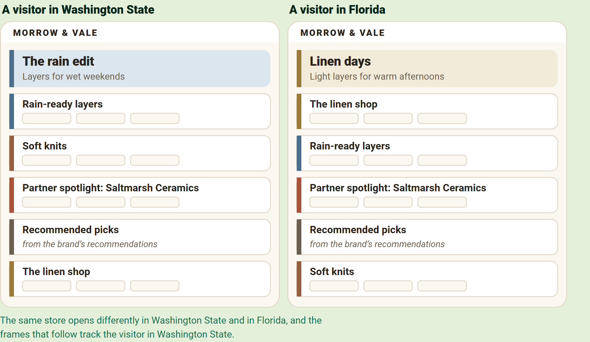
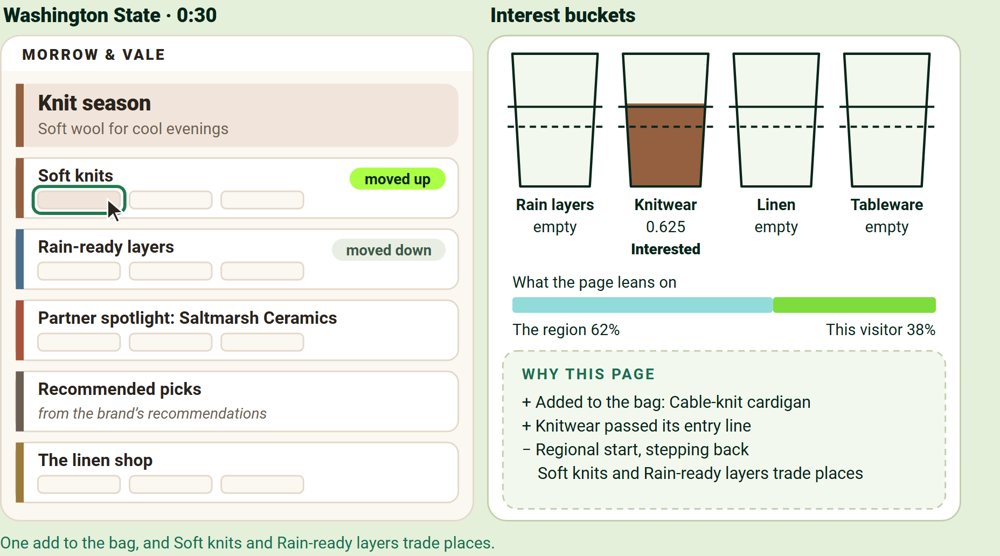
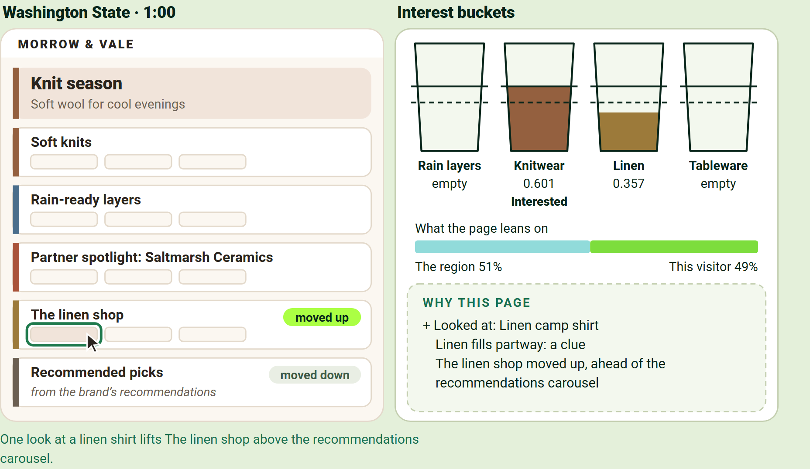
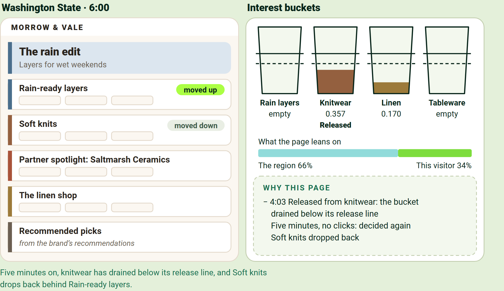
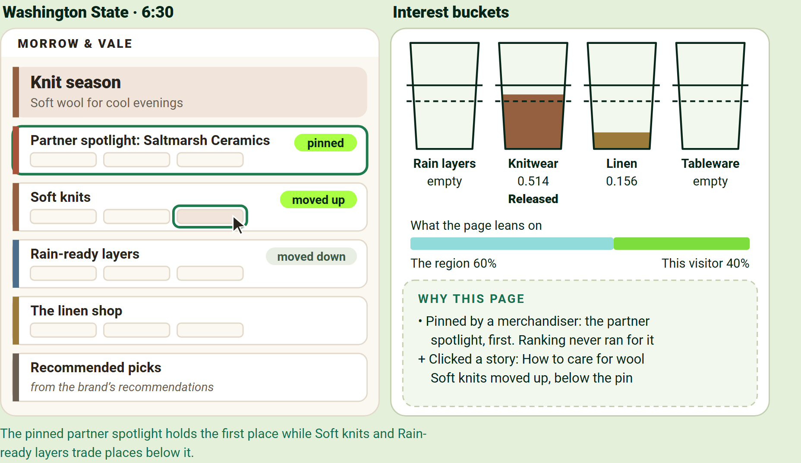
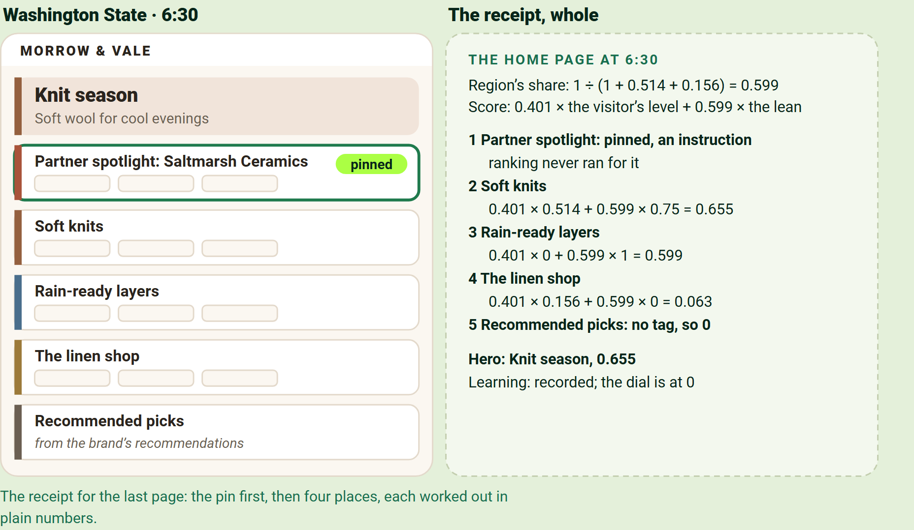
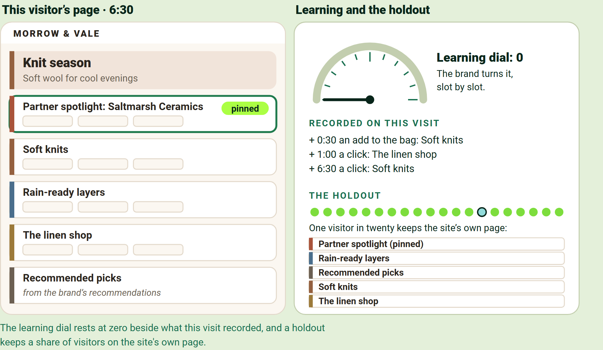

# Behavioral Targeting and Intelligence: see it work

One visitor, seven moments, on a sample store: press Show me, or click what is highlighted.

## The first page feels local

Before any click, the engine knows only the visitor's region, so the sections visitors there lean toward come first. The store and its regional leans are invented for this tour.

## The first click changes the page

A click pours into the bucket for what it touches. An add to the bag counts three times a look, so that bucket passes its entry line at once and two sections trade places.

We aim to make each decision within about 200 milliseconds at the edge; on average we see 50 to 250 milliseconds, and tens of milliseconds once the engine has seen the visitor.

## A second interest fills

A look at something different fills a second bucket partway: a clue, not a conclusion. The page leans on both, and the second interest's section climbs past the brand's recommendations carousel.

Recommendations rank the past; the engine decides the page at the point in time, and the two work side by side.

## The first bucket drains, and the visitor is released

Every bucket drains on its own: below its release line the visitor is released, the section drops back, and nobody wrote an expiration rule. This sample store keeps interest for five minutes so the tour can show it; the engine's default is 14 days.

## A pin holds its place

A merchandiser sold the partner spotlight the first place, so the brand pins it there. It holds while the sections below reorder, and the receipt says ranking never ran for it.

## Every decision comes with a receipt

The receipt shows what was served, where, and the arithmetic behind it, so a person can recompute the page by hand. The less the engine has seen of the visitor, the more the region counts.

The engine calls no AI model to decide. Opal is where people ask and generative AI creates, and that is where credits apply.

## Learning waits for the brand's dial

A holdout keeps a share of visitors on the site's own page, so the brand measures the lift on its own numbers. The whole story is on [What it is](https://edge-platform-bti.expedge.workers.dev/what-it-is), and every constant has an instrument on [How it works, interactive](https://edge-platform-bti.expedge.workers.dev/how-it-works-interactive).

It records what works from the first day and changes nothing until the brand turns the dial.

