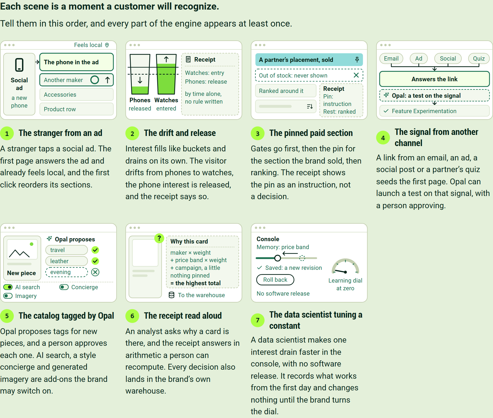
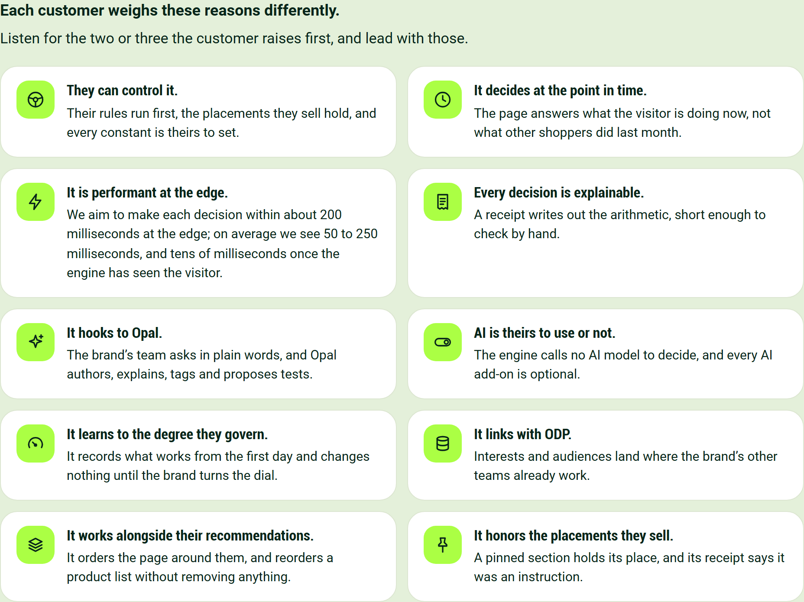
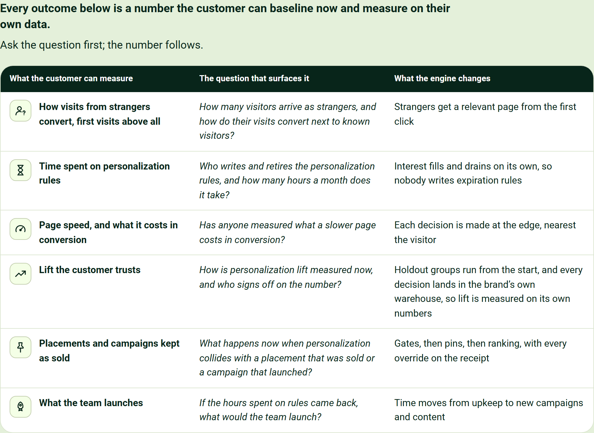
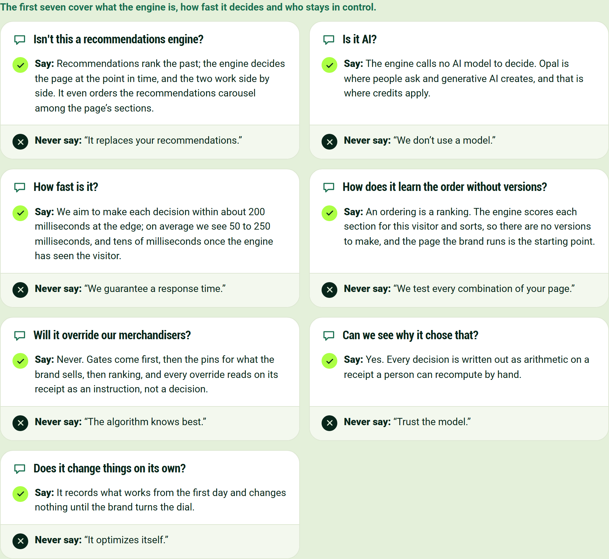
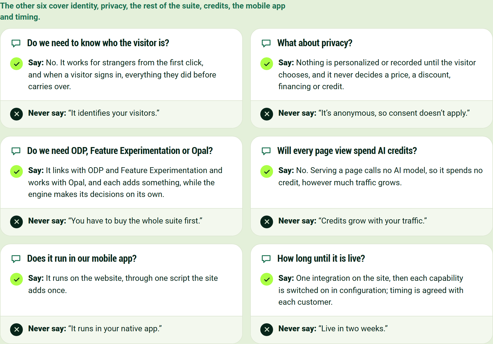
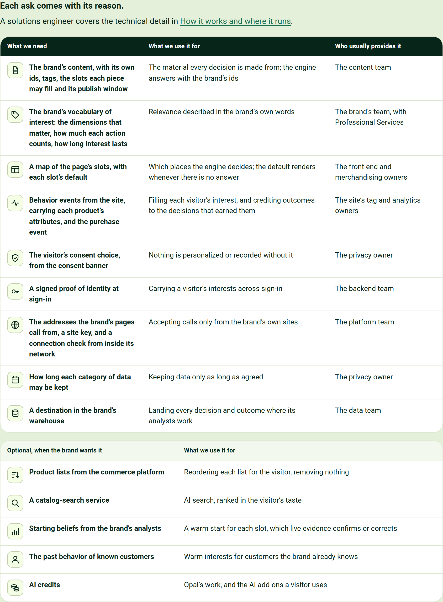
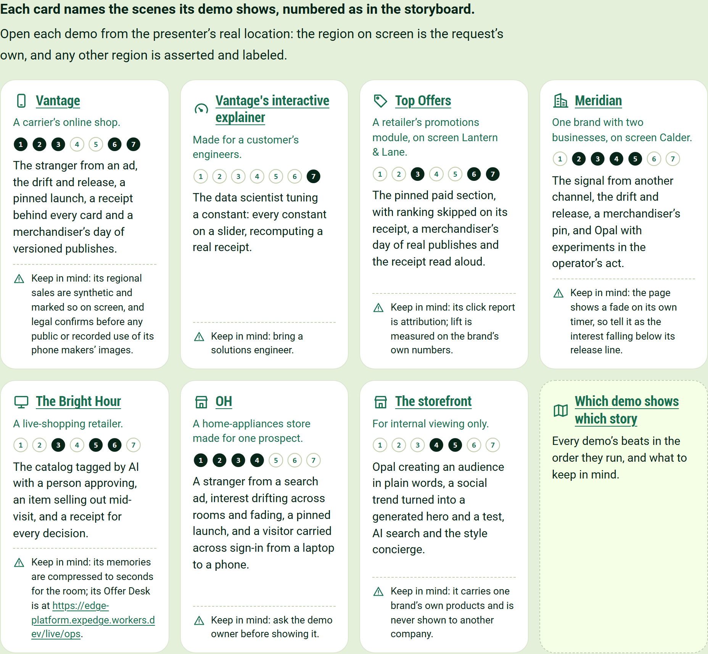
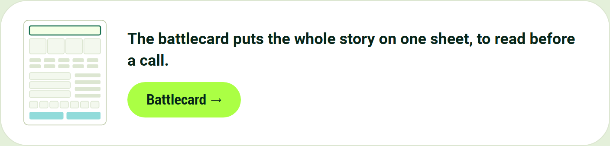

# Behavioral Targeting and Intelligence: selling it

For account executives, who tell the story to a customer and answer what comes back.

## Seven scenes carry the whole story

Tell them in this order, and every part of the engine appears at least once.

**The stranger from an ad**

A stranger taps a social ad. The first page answers the ad and already feels local, and the first click reorders its sections.

**The drift and release**

Interest fills like buckets and drains on its own. The visitor drifts from phones to watches, the phone interest is released, and the receipt says so.

**The pinned paid section**

Gates go first, then the pin for the section the brand sold, then ranking. The receipt shows the pin as an instruction, not a decision.

**The signal from another channel**

A link from an email, an ad, a social post or a partner's quiz seeds the first page. Opal can launch a test on that signal, with a person approving.

**The catalog tagged by Opal**

Opal proposes tags for new pieces, and a person approves each one. AI search, a style concierge and generated imagery are add-ons the brand may switch on.

**The receipt read aloud**

An analyst asks why a card is there, and the receipt answers in arithmetic a person can recompute. Every decision also lands in the brand's own warehouse.

**The data scientist tuning a constant**

A data scientist makes one interest drain faster in the console, with no software release. It records what works from the first day and changes nothing until the brand turns the dial.

## Customers choose it for different reasons

Listen for the two or three the customer raises first, and lead with those.

- **They can control it.** Their rules run first, the placements they sell hold, and every constant is theirs to set.
- **It decides at the point in time.** The page answers what the visitor is doing now, not what other shoppers did last month.
- **It is performant at the edge.** We aim to make each decision within about 200 milliseconds at the edge; on average we see 50 to 250 milliseconds, and tens of milliseconds once the engine has seen the visitor.
- **Every decision is explainable.** A receipt writes out the arithmetic, short enough to check by hand.
- **It hooks to Opal.** The brand's team asks in plain words, and Opal authors, explains, tags and proposes tests.
- **AI is theirs to use or not.** The engine calls no AI model to decide, and every AI add-on is optional.
- **It learns to the degree they govern.** It records what works from the first day and changes nothing until the brand turns the dial.
- **It links with ODP.** Interests and audiences land where the brand's other teams already work.
- **It works alongside their recommendations.** It orders the page around them, and reorders a product list without removing anything.
- **It honors the placements they sell.** A pinned section holds its place, and its receipt says it was an instruction.

Where AI fits, and where credits apply, is set out in [Where Opal and AI Credits Fit, and Where They Never Do](https://edge-platform-bti.expedge.workers.dev/credits).

## A customer can measure six outcomes, and one question surfaces each

Ask the question first; the number follows.

| What the customer can measure | The question that surfaces it | What the engine changes |
|---|---|---|
| How visits from strangers convert, first visits above all | How many visitors arrive as strangers, and how do their visits convert next to known visitors? | Strangers get a relevant page from the first click |
| Time spent on personalization rules | Who writes and retires the personalization rules, and how many hours a month does it take? | Interest fills and drains on its own, so nobody writes expiration rules |
| Page speed, and what it costs in conversion | Has anyone measured what a slower page costs in conversion? | Each decision is made at the edge, nearest the visitor |
| Lift the customer trusts | How is personalization lift measured now, and who signs off on the number? | Holdout groups run from the start, and every decision lands in the brand's own warehouse, so lift is measured on its own numbers |
| Placements and campaigns kept as sold | What happens now when personalization collides with a placement that was sold or a campaign that launched? | Gates, then pins, then ranking, with every override on the receipt |
| What the team launches | If the hours spent on rules came back, what would the team launch? | Time moves from upkeep to new campaigns and content |

## Objections have short, true answers

Each objection comes with the sentence to say and the sentence never to say.

> "How else would it learn? I don't understand."

A program lead at a luxury retailer, on how a page could learn its order without versions to learn from.

The answer was one sentence: an ordering is a ranking.

**Isn't this a recommendations engine?**

Say: Recommendations rank the past; the engine decides the page at the point in time, and the two work side by side. It even orders the recommendations carousel among the page's sections.

Never say: "It replaces your recommendations."

**Is it AI?**

Say: The engine calls no AI model to decide. Opal is where people ask and generative AI creates, and that is where credits apply.

Never say: "We don't use a model."

**How fast is it?**

Say: We aim to make each decision within about 200 milliseconds at the edge; on average we see 50 to 250 milliseconds, and tens of milliseconds once the engine has seen the visitor.

Never say: "We guarantee a response time."

**How does it learn the order without versions?**

Say: An ordering is a ranking. The engine scores each section for this visitor and sorts, so there are no versions to make, and the page the brand runs is the starting point.

Never say: "We test every combination of your page."

**Will it override our merchandisers?**

Say: Never. Gates come first, then the pins for what the brand sells, then ranking, and every override reads on its receipt as an instruction, not a decision.

Never say: "The algorithm knows best."

**Can we see why it chose that?**

Say: Yes. Every decision is written out as arithmetic on a receipt a person can recompute by hand.

Never say: "Trust the model."

**Does it change things on its own?**

Say: It records what works from the first day and changes nothing until the brand turns the dial.

Never say: "It optimizes itself."

**Do we need to know who the visitor is?**

Say: No. It works for strangers from the first click, and when a visitor signs in, everything they did before carries over.

Never say: "It identifies your visitors."

**What about privacy?**

Say: Nothing is personalized or recorded until the visitor chooses, and it never decides a price, a discount, financing or credit.

Never say: "It's anonymous, so consent doesn't apply."

**Do we need ODP, Feature Experimentation or Opal?**

Say: It links with ODP and Feature Experimentation and works with Opal, and each adds something, while the engine makes its decisions on its own.

Never say: "You have to buy the whole suite first."

**Will every page view spend AI credits?**

Say: No. Serving a page calls no AI model, so it spends no credit, however much traffic grows.

Never say: "Credits grow with your traffic."

**Does it run in our mobile app?**

Say: It runs on the website, through one script the site adds once.

Never say: "It runs in your native app."

**How long until it is live?**

Say: One integration on the site, then each capability is switched on in configuration; timing is agreed with each customer.

Never say: "Live in two weeks."

## Every ask says what we need and what we use it for

A solutions engineer covers the technical detail in [How it works and where it runs](https://edge-platform-bti.expedge.workers.dev/how-it-works).

| What we need | What we use it for | Who usually provides it |
|---|---|---|
| The brand's content, with its own ids, tags, the slots each piece may fill and its publish window | The material every decision is made from; the engine answers with the brand's ids | The content team |
| The brand's vocabulary of interest: the dimensions that matter, how much each action counts, how long interest lasts | Relevance described in the brand's own words | The brand's team, with Professional Services |
| A map of the page's slots, with each slot's default | Which places the engine decides; the default renders whenever there is no answer | The front-end and merchandising owners |
| Behavior events from the site, carrying each product's attributes, and the purchase event | Filling each visitor's interest, and crediting outcomes to the decisions that earned them | The site's tag and analytics owners |
| The visitor's consent choice, from the consent banner | Nothing is personalized or recorded without it | The privacy owner |
| A signed proof of identity at sign-in | Carrying a visitor's interests across sign-in | The backend team |
| The addresses the brand's pages call from, a site key, and a connection check from inside its network | Accepting calls only from the brand's own sites | The platform team |
| How long each category of data may be kept | Keeping data only as long as agreed | The privacy owner |
| A destination in the brand's warehouse | Landing every decision and outcome where its analysts work | The data team |

| Optional, when the brand wants it | What we use it for |
|---|---|
| Product lists from the commerce platform | Reordering each list for the visitor, removing nothing |
| A catalog-search service | AI search, ranked in the visitor's taste |
| Starting beliefs from the brand's analysts | A warm start for each slot, which live evidence confirms or corrects |
| The past behavior of known customers | Warm interests for customers the brand already knows |
| AI credits | Opal's work, and the AI add-ons a visitor uses |

## Each hosted demo tells part of the story

Open each demo from the presenter's real location: the region on screen is the request's own, and any other region is asserted and labeled.

**[Vantage](https://edge-platform-vantage.expedge.workers.dev/vantage/)**

A carrier's online shop.

The stranger from an ad, the drift and release, a pinned launch, a receipt behind every card and a merchandiser's day of versioned publishes.

Keep in mind: its regional sales are synthetic and marked so on screen, and legal confirms before any public or recorded use of its phone makers' images.

**[Vantage's interactive explainer](https://edge-platform-vantage.expedge.workers.dev/vantage/how-it-works)**

Made for a customer's engineers.

The data scientist tuning a constant: every constant on a slider, recomputing a real receipt.

Keep in mind: bring a solutions engineer.

**[Top Offers](https://edge-platform-top-offers.expedge.workers.dev/top-offers/)**

A retailer's promotions module, on screen Lantern & Lane.

The pinned paid section, with ranking skipped on its receipt, a merchandiser's day of real publishes and the receipt read aloud.

Keep in mind: its click report is attribution; lift is measured on the brand's own numbers.

**[Meridian](https://edge-platform.expedge.workers.dev/meridian/)**

One brand with two businesses, on screen Calder.

The signal from another channel, the drift and release, a merchandiser's pin, and Opal with experiments in the operator's act.

Keep in mind: the page shows a fade on its own timer, so tell it as the interest falling below its release line.

**[The Bright Hour](https://edge-platform.expedge.workers.dev/live/)**

A live-shopping retailer.

The catalog tagged by AI with a person approving, an item selling out mid-visit, and a receipt for every decision.

Keep in mind: its memories are compressed to seconds for the room; its Offer Desk is at [https://edge-platform.expedge.workers.dev/live/ops](https://edge-platform.expedge.workers.dev/live/ops).

**[OH](https://edge-platform-oh.expedge.workers.dev/oh/)**

A home-appliances store made for one prospect.

A stranger from a search ad, interest drifting across rooms and fading, a pinned launch, and a visitor carried across sign-in from a laptop to a phone.

Keep in mind: ask the demo owner before showing it.

**[The storefront](https://edge-platform.expedge.workers.dev/storefront)**

For internal viewing only.

Opal creating an audience in plain words, a social trend turned into a generated hero and a test, AI search and the style concierge.

Keep in mind: it carries one brand's own products and is never shown to another company.

**[Which demo shows which story](https://edge-platform-bti.expedge.workers.dev/demos)**

Every demo's beats in the order they run, and what to keep in mind.

## The battlecard fits the story on one sheet

[Battlecard](https://edge-platform-bti.expedge.workers.dev/battlecard)
