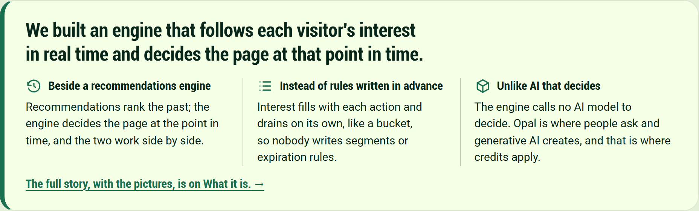

# Behavioral Targeting and Intelligence: the spine, one band

We built an engine that follows each visitor's interest in real time and decides the page at that point in time.

**Beside a recommendations engine**

Recommendations rank the past; the engine decides the page at the point in time, and the two work side by side.

**Instead of rules written in advance**

Interest fills with each action and drains on its own, like a bucket, so nobody writes segments or expiration rules.

**Unlike AI that decides**

The engine calls no AI model to decide. Opal is where people ask and generative AI creates, and that is where credits apply.

[The full story, with the pictures, is on What it is.](https://edge-platform-bti.expedge.workers.dev/what-it-is)
