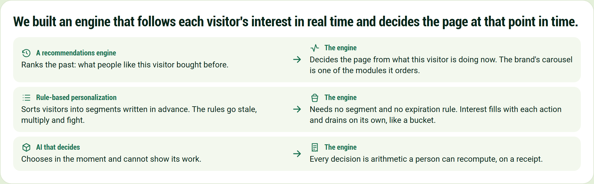

# Behavioral Targeting and Intelligence: the spine, short form

We built an engine that follows each visitor's interest in real time and decides the page at that point in time.

**A recommendations engine**

Ranks the past: what people like this visitor bought before.

**The engine**

Decides the page from what this visitor is doing now. The brand's carousel is one of the modules it orders.

**Rule-based personalization**

Sorts visitors into segments written in advance. The rules go stale, multiply and fight.

**The engine**

Needs no segment and no expiration rule. Interest fills with each action and drains on its own, like a bucket.

**AI that decides**

Chooses in the moment and cannot show its work.

**The engine**

Every decision is arithmetic a person can recompute, on a receipt.
