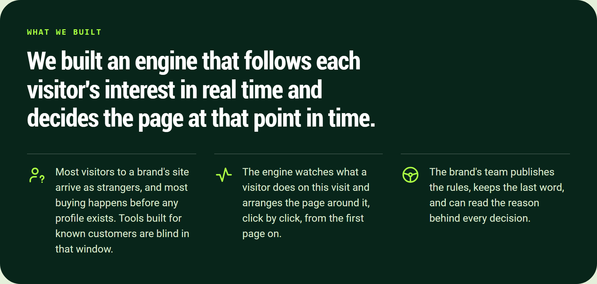
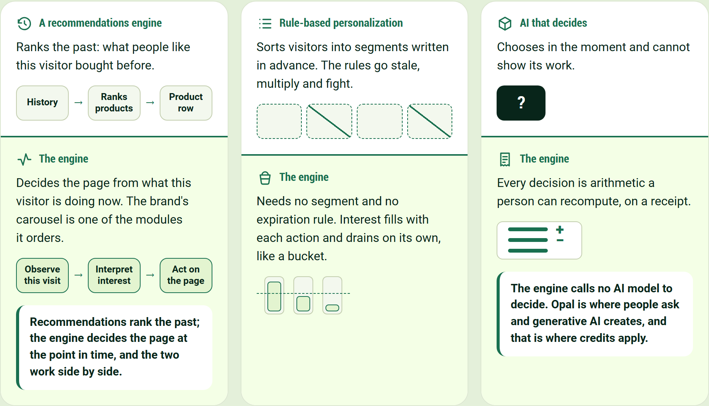
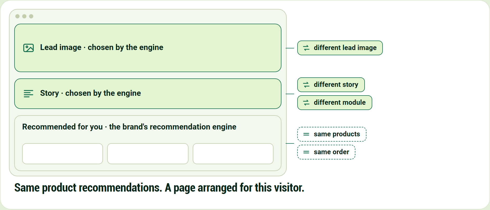
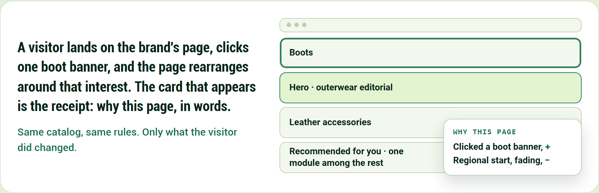
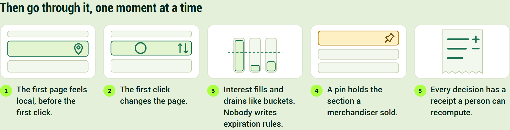

# Behavioral Targeting and Intelligence: the spine

## What we built

We built an engine that follows each visitor's interest in real time and decides the page at that point in time.

- Most visitors to a brand's site arrive as strangers, and most buying happens before any profile exists. Tools built for known customers are blind in that window.
- The engine watches what a visitor does on this visit and arranges the page around it, click by click, from the first page on.
- The brand's team publishes the rules, keeps the last word, and can read the reason behind every decision.

## How it differs from recommendations and from personalization, and why

**A recommendations engine**

Ranks the past: what people like this visitor bought before.

History → Ranks products → Product row

**The engine**

Decides the page from what this visitor is doing now. The brand's carousel is one of the modules it orders.

Observe this visit → Interpret interest → Act on the page

Recommendations rank the past; the engine decides the page at the point in time, and the two work side by side.

**Rule-based personalization**

Sorts visitors into segments written in advance. The rules go stale, multiply and fight.

**The engine**

Needs no segment and no expiration rule. Interest fills with each action and drains on its own, like a bucket.

**AI that decides**

Chooses in the moment and cannot show its work.

**The engine**

Every decision is arithmetic a person can recompute, on a receipt.

The engine calls no AI model to decide. Opal is where people ask and generative AI creates, and that is where credits apply.

## Both engines on one page

One engine keeps choosing the products. The other decides the experience around them.

Lead image · chosen by the engine

Story · chosen by the engine

Recommended for you · the brand's recommendation engine

- same products
- same order
- different lead image
- different story
- different module

Same product recommendations. A page arranged for this visitor.

## Now watch it: one visitor, one click

A visitor lands on the brand's page, clicks one boot banner, and the page rearranges around that interest. The card that appears is the receipt: why this page, in words.

Same catalog, same rules. Only what the visitor did changed.

1. Hero · outerwear editorial
2. Boots
3. Leather accessories
4. Recommended for you · one module among the rest

Why this page

- Clicked a boot banner, +
- Regional start, fading, −

## Then go through it, one moment at a time

1. The first page feels local, before the first click.
2. The first click changes the page.
3. Interest fills and drains like buckets. Nobody writes expiration rules.
4. A pin holds the section a merchandiser sold.
5. Every decision has a receipt a person can recompute.
