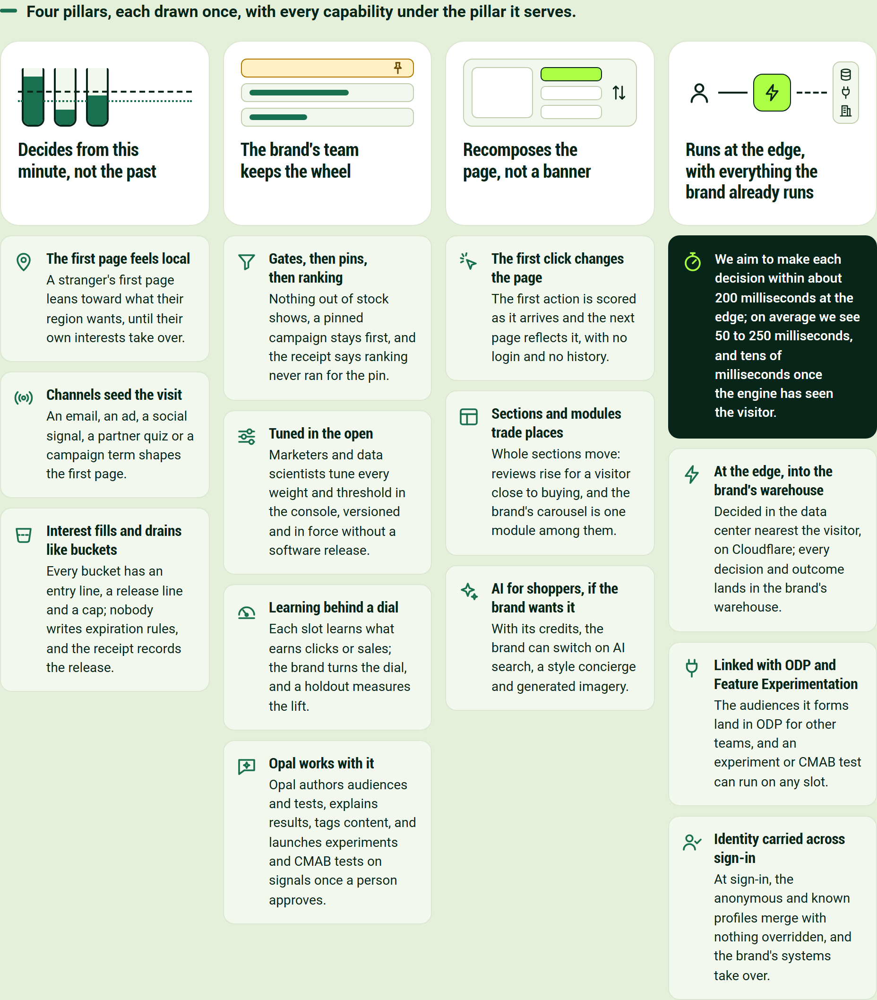
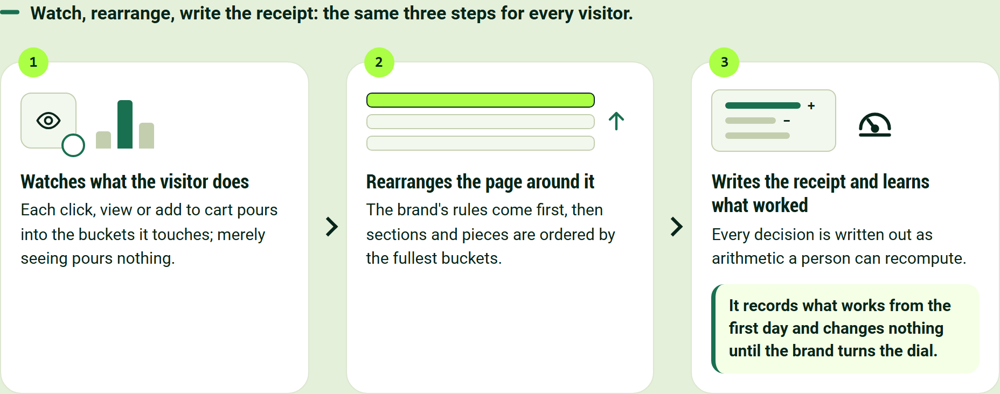
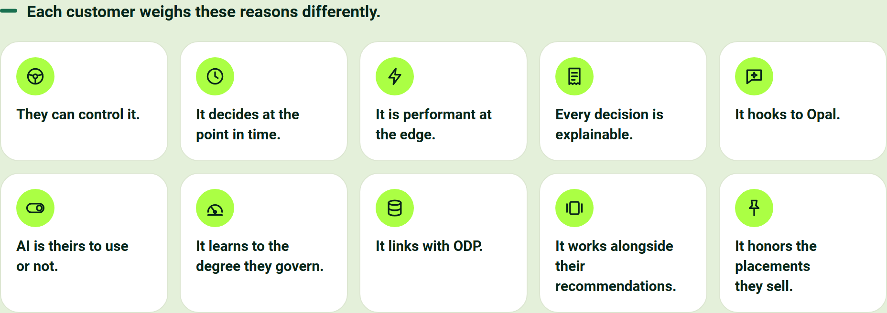
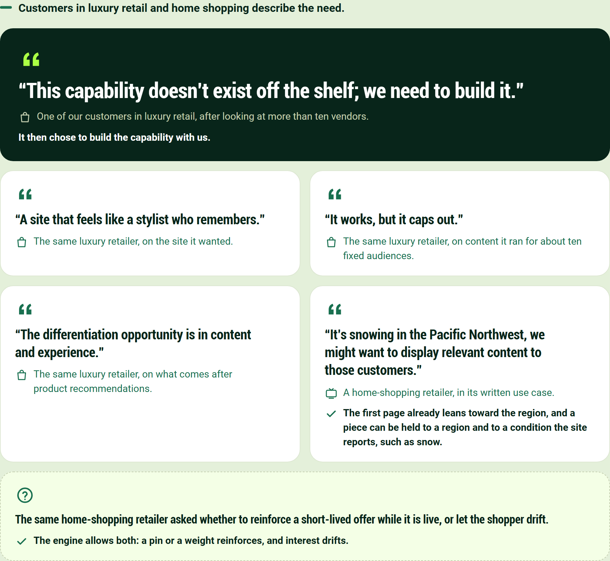
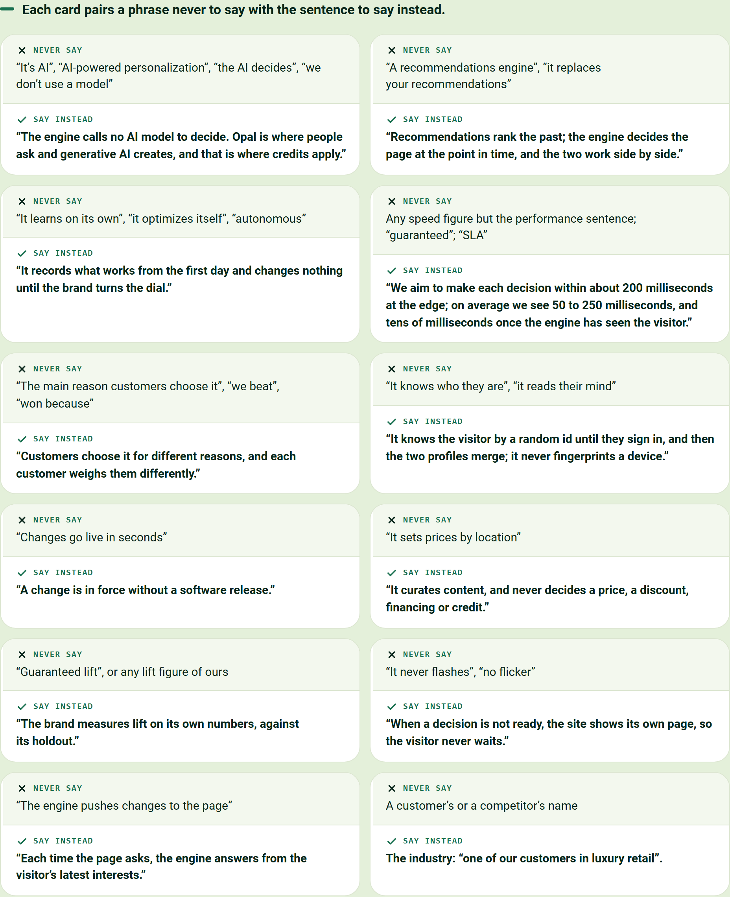
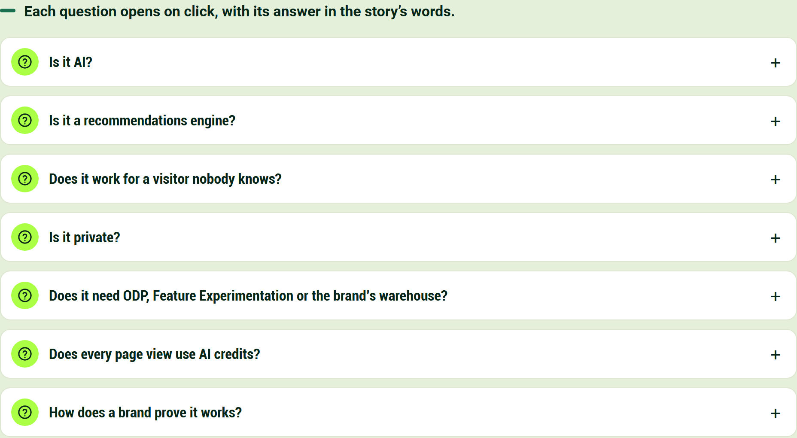
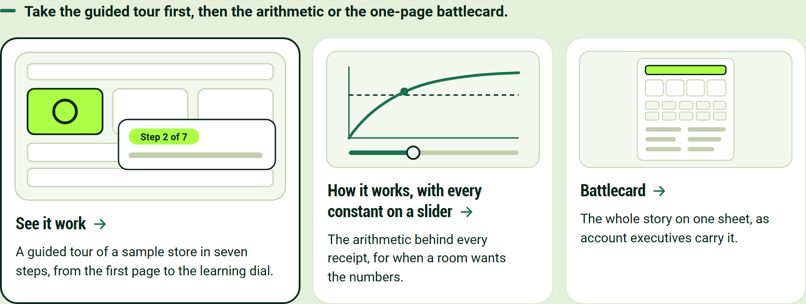

# Behavioral Targeting and Intelligence: what it is

For marketing: what the engine does and why customers choose it, in pictures to retell.

## Every capability stands on one of four pillars

**Decides from this minute, not the past**

- **The first page feels local.** A stranger's first page leans toward what their region wants, until their own interests take over.
- **Channels seed the visit.** An email, an ad, a social signal, a partner quiz or a campaign term shapes the first page.
- **Interest fills and drains like buckets.** Every bucket has an entry line, a release line and a cap; nobody writes expiration rules, and the receipt records the release.

**The brand's team keeps the wheel**

- **Gates, then pins, then ranking.** Nothing out of stock shows, a pinned campaign stays first, and the receipt says ranking never ran for the pin.
- **Tuned in the open.** Marketers and data scientists tune every weight and threshold in the console, versioned and in force without a software release.
- **Learning behind a dial.** Each slot learns what earns clicks or sales; the brand turns the dial, and a holdout measures the lift.
- **Opal works with it.** Opal authors audiences and tests, explains results, tags content, and launches experiments and CMAB tests on signals once a person approves.

**Recomposes the page, not a banner**

- **The first click changes the page.** The first action is scored as it arrives and the next page reflects it, with no login and no history.
- **Sections and modules trade places.** Whole sections move: reviews rise for a visitor close to buying, and the brand's carousel is one module among them.
- **AI for shoppers, if the brand wants it.** With its credits, the brand can switch on AI search, a style concierge and generated imagery.

**Runs at the edge, with everything the brand already runs**

We aim to make each decision within about 200 milliseconds at the edge; on average we see 50 to 250 milliseconds, and tens of milliseconds once the engine has seen the visitor.

- **At the edge, into the brand's warehouse.** Decided in the data center nearest the visitor, on Cloudflare; every decision and outcome lands in the brand's warehouse.
- **Linked with ODP and Feature Experimentation.** The audiences it forms land in ODP for other teams, and an experiment or CMAB test can run on any slot.
- **Identity carried across sign-in.** At sign-in, the anonymous and known profiles merge with nothing overridden, and the brand's systems take over.

## It works in three steps, every time a page asks

1. **Watches what the visitor does.** Each click, view or add to cart pours into the buckets it touches; merely seeing pours nothing.
2. **Rearranges the page around it.** The brand's rules come first, then sections and pieces are ordered by the fullest buckets.
3. **Writes the receipt and learns what worked.** Every decision is written out as arithmetic a person can recompute.

It records what works from the first day and changes nothing until the brand turns the dial.

## Customers choose it for different reasons

- They can control it.
- It decides at the point in time.
- It is performant at the edge.
- Every decision is explainable.
- It hooks to Opal.
- AI is theirs to use or not.
- It learns to the degree they govern.
- It links with ODP.
- It works alongside their recommendations.
- It honors the placements they sell.

## Customers put the need in their own words

> "This capability doesn't exist off the shelf; we need to build it."

One of our customers in luxury retail, after looking at more than ten vendors. It then chose to build the capability with us.

> "A site that feels like a stylist who remembers."

The same luxury retailer, on the site it wanted.

> "It works, but it caps out."

The same luxury retailer, on content it ran for about ten fixed audiences.

> "The differentiation opportunity is in content and experience."

The same luxury retailer, on what comes after product recommendations.

> "It's snowing in the Pacific Northwest, we might want to display relevant content to those customers."

A home-shopping retailer, in its written use case.

The first page already leans toward the region, and a piece can be held to a region and to a condition the site reports, such as snow.

The same home-shopping retailer asked whether to reinforce a short-lived offer while it is live, or let the shopper drift.

The engine allows both: a pin or a weight reinforces, and interest drifts.

## Some phrases mislead, and each has a better one

| Never say | Say instead |
|---|---|
| "It's AI", "AI-powered personalization", "the AI decides", "we don't use a model" | "The engine calls no AI model to decide. Opal is where people ask and generative AI creates, and that is where credits apply." |
| "A recommendations engine", "it replaces your recommendations" | "Recommendations rank the past; the engine decides the page at the point in time, and the two work side by side." |
| "It learns on its own", "it optimizes itself", "autonomous" | "It records what works from the first day and changes nothing until the brand turns the dial." |
| Any speed figure but the performance sentence; "guaranteed"; "SLA" | "We aim to make each decision within about 200 milliseconds at the edge; on average we see 50 to 250 milliseconds, and tens of milliseconds once the engine has seen the visitor." |
| "The main reason customers choose it", "we beat", "won because" | "Customers choose it for different reasons, and each customer weighs them differently." |
| "It knows who they are", "it reads their mind" | "It knows the visitor by a random id until they sign in, and then the two profiles merge; it never fingerprints a device." |
| "Changes go live in seconds" | "A change is in force without a software release." |
| "It sets prices by location" | "It curates content, and never decides a price, a discount, financing or credit." |
| "Guaranteed lift", or any lift figure of ours | "The brand measures lift on its own numbers, against its holdout." |
| "It never flashes", "no flicker" | "When a decision is not ready, the site shows its own page, so the visitor never waits." |
| "The engine pushes changes to the page" | "Each time the page asks, the engine answers from the visitor's latest interests." |
| A customer's or a competitor's name | The industry: "one of our customers in luxury retail". |

## Marketing will be asked these questions

**Is it AI?**

No AI model decides what a visitor sees. Like a stylist with a good memory, the engine notices what the visitor does, keeps score in its buckets and follows the brand's rules, so every decision can be checked by hand. AI works beside it, in Opal and in the optional add-ons.

**Is it a recommendations engine?**

No, and it does not replace one. Recommendations rank the past; the engine decides the page at the point in time, and the two work side by side. The brand's carousel is one of the modules it orders.

**Does it work for a visitor nobody knows?**

Yes, that is what it is for. It needs no login and no history: the first page already leans toward what visitors in the region want, and the first click changes the page.

**Is it private?**

It honors each visitor's consent choice. It keeps interests, not names: a visitor stays anonymous until they sign in, and a known customer is stored under a salted one-way code.

It reads no device detail beyond the operating system family of the visitor's phone, uses no third-party data, curates content but never prices, and forgets a visitor who asks.

**Does it need ODP, Feature Experimentation or the brand's warehouse?**

It works on its own and links with each: ODP receives the interests and audiences it forms, Feature Experimentation runs the tests Opal proposes, and the warehouse receives every decision and outcome. No decision waits on any of them.

**Does every page view use AI credits?**

No. Serving a page spends no credit; credits follow where people use AI, in Opal or in an add-on the brand has switched on, never page views. The rest is on the page [Where Opal and AI Credits Fit, and Where They Never Do](https://edge-platform-bti.expedge.workers.dev/credits).

**How does a brand prove it works?**

A holdout group keeps seeing the brand's own page from the start, and the brand's analysts compare the two on their own numbers. The engine never grades its own homework.

## The tour shows it on a page, one step at a time

- **[See it work](https://edge-platform-bti.expedge.workers.dev/see-it-work).** A guided tour of a sample store in seven steps, from the first page to the learning dial.
- **[How it works, with every constant on a slider](https://edge-platform-bti.expedge.workers.dev/how-it-works-interactive).** The arithmetic behind every receipt, for when a room wants the numbers.
- **[Battlecard](https://edge-platform-bti.expedge.workers.dev/battlecard).** The whole story on one sheet, as account executives carry it.
